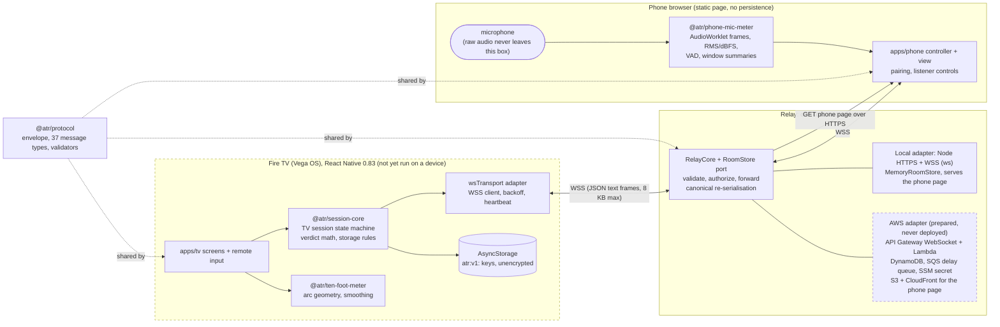
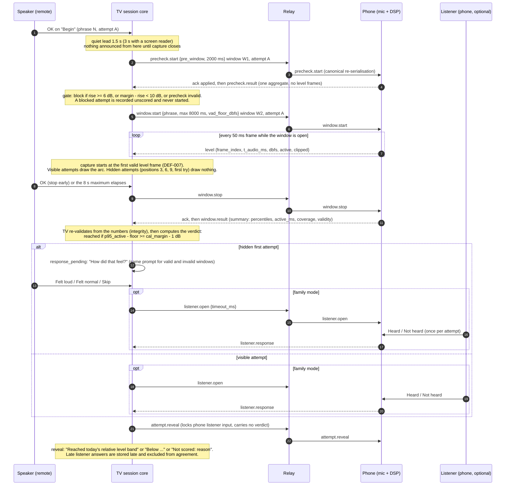
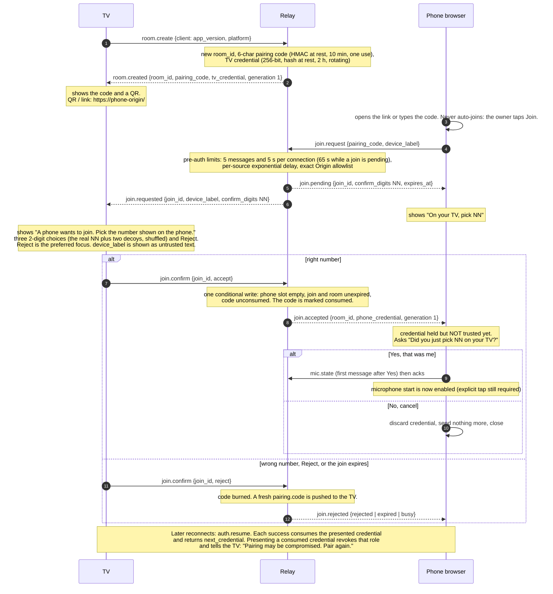
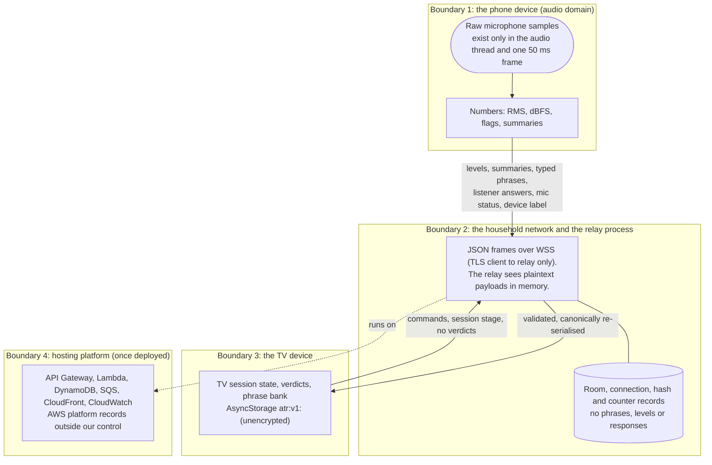
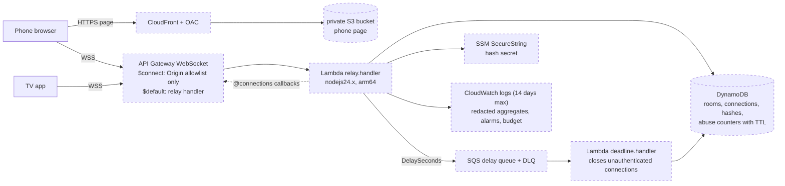

# Architecture

Status: describes the code at integration commit `63af0ae` (protocol revision 4, ADR revision 2). It is a map of what exists, not a claim about what has run on a Fire TV: **no Vega SDK, Vega Virtual Device, physical Android phone, physical Fire TV or AWS account was available** (blockers B-001 to B-004), so every runtime statement below is backed by automated tests with fakes, synthetic audio in desktop Chrome, a headless TV core, or the AWS adapter run against an in-memory model. See [LIMITATIONS.md](LIMITATIONS.md) for the measured-versus-fixture table.

Product framing, as shown on every TV screen: **Not a medical device. Does not diagnose or treat any condition.** The phone measures a *relative digital level* against a room floor measured minutes earlier. It is not dB SPL, not intelligibility, not a hearing or clinical measure ([MEASUREMENT.md](MEASUREMENT.md)).

## 1. Components

Dashed boxes have **not** been run: the TV app type-checks against the published `@amazon-devices/*` packages and passes its jest suite with mocked native modules, but was never built for or run on Vega; the AWS adapter passes its tests against fakes and a strict DynamoDB model and passes `cfn-lint`, but nothing was deployed.

| Component | Path | Role | Runtime dependencies |
|---|---|---|---|
| Protocol | `packages/protocol` | The only definition of the wire format: envelope, 37 message types, direction and auth rules, validators, id and credential helpers. `docs/PROTOCOL.md` is tested against it. | none |
| Phone meter | `packages/phone-mic-meter` | Pure DSP (50 ms frames, RMS, dBFS, floor, hysteresis VAD, window summaries, quantisation) plus a browser capture adapter (AudioWorklet). No network, no storage, no recorder. | none (workspace: protocol for types) |
| Ten-foot meter | `packages/ten-foot-meter` | Arc geometry, smoothing and cue helpers for the TV meter. | none |
| Session core | `packages/session-core` | The TV's authoritative session state machine, verdict maths, listener and reveal rules, storage rules, copy strings. Pure; time and ids are injected. See `packages/session-core/STATE_MACHINE.md`. | protocol |
| TV app | `apps/tv` | React Native for Vega shell: screens, remote focus, QR, WSS adapter, AsyncStorage adapter. Standalone Node 22 project. | `@amazon-devices/*`, `react-native` 0.83.0, `react` 19.2.0, `qrcode-generator` |
| Phone app | `apps/phone` | Plain TypeScript page built with Vite: join, number confirmation, microphone, phrase editor, listener controls. See `apps/phone/STATE_MACHINE.md`. | none at runtime |
| Relay | `services/relay` | `src/core` (RelayCore), `src/local` (Node server), `src/aws` (Lambda handlers). See `services/relay/README.md`. | `ws`, AWS SDK v3 clients |
| Infrastructure | `infra/template.yaml` | SAM template for the AWS adapter. Lint-validated, never deployed. | n/a |
| Tests | `tests` | Independent review suite, TV web-preview accessibility gate, end-to-end and fault-recovery journeys. | dev only |

Division of authority: the **TV owns practice state, verdicts and stored summaries**; the **phone owns audio** and sends only numbers; the **relay validates and forwards** application events and stores room and connection metadata only. No AI model, speech recogniser or cloud service scores anything.

## 2. One phrase attempt, end to end

The numbers come from ADR-0001 (as amended in `docs/adr/AMENDMENTS-REV2.md`) and `packages/session-core/STATE_MACHINE.md`. Every message passes `RelayCore.processInbound`; the TV and phone re-validate with the same package.

Facts that shape this flow:

- `window_id` is unique per measurement: the precheck (W1) and the capture (W2) differ, and share the `attempt_id` (DEF-002, protocol revision 4). A retry gets new ids.
- The phone never receives the verdict, the arc, or which positions are blind. It sees `session.state` stage `phrase_active` from capture start until the next `phrase_ready` or `summary` (QA-05); `listener.open` is the explicit signal.
- A window that is cancelled, interrupted, clipped, silent, noisy, stale or never started is **unscored**; a reconnect never resumes scoring ([ADR-0006](adr/0006-transport-local-relay-no-polling.md), A6-02).
- The quiet check (5 s) is a `precheck.start` with purpose `quiet_check`; calibration (6 s) is a `window.start` of kind `calibration`. Neither goes through the pre-window gate. The sustained-vowel window is optional (up to 30 s) and is gated only when a band exists.

## 3. Pairing: number matching plus phone confirmation

ADR-0003 as amended by A3-01 (blocker, accepted), A3-02, A3-04, A3-06 and A3-07. The pairing code is a locator, never authentication. Two human checks happen: the TV owner picks the right number, then the phone owner confirms they did so.

The second human check exists because a hostile QR code can point the phone at an attacker's relay that accepts anyone: "accepted" proves nothing about whose room it is. Until the phone owner answers Yes, the phone sends only the join protocol and `ping`, drops TV commands without acknowledging them, and never opens the microphone (`apps/phone/STATE_MACHINE.md`, invariant 8). A hostile-QR scenario is part of the phone's real-Chrome end-to-end script (`apps/phone/e2e/hostile-qr.mjs`).

## 4. Trust boundaries

| Boundary | What is trusted | What is never trusted | Where it is enforced |
|---|---|---|---|
| Phone to relay to TV | A connection that authenticated with a role credential, holds the current role epoch and generation, and sends a type that role may send | Message content (shape, range and size only are checked), `client.platform` (self-declared), `mic.state.mode` (a label), device label (shown as untrusted text), `Origin` (a browser protection, not identity) | `RelayCore.processInbound` (ADR-0003 section 9), `@atr/protocol` validators, TV re-validation (A1-09, PK-09) |
| Pairing | The TV owner picking the correct number, then the phone owner confirming | The pairing code alone; the relay saying "accepted"; a QR code | ADR-0003 A3-01 and A3-06, phone gate in the single send function |
| Audio | Nothing leaves the audio module except per-frame numbers | Browser settings reports (`getSettings` is a request, not proof of unprocessed audio) | `packages/phone-mic-meter` (no network, storage or recorder; scan test), phone bundle scan for `MediaRecorder` and storage APIs |
| TV storage | The TV's own app sandbox | Stored values on read (validated like wire data; corrupt values treated as absent) | ADR-0005 and amendments A5-01 to A5-05 |
| Relay platform | TLS from clients to the relay | Anything beyond the relay: API Gateway and Lambda handle plaintext in memory; message bodies are never logged | ADR-0002 A2-04 and A2-05, IaC assertions in `services/relay/test/infra.test.ts` |

The relay is **not** end-to-end encrypted and does inspect payloads to validate them. The forbidden claims are "end-to-end encrypted", "no data leaves the household", "only numbers" and "relay never inspects payloads" ([PRIVACY.md](PRIVACY.md)).

## 5. Where each ADR applies

All ADRs are in `docs/adr/`; where `AMENDMENTS-REV2.md` conflicts with a revision 1 ADR text, the amendments win.

| ADR | Decision in one line | Implemented in |
|---|---|---|
| [0001](adr/0001-measurement-contract.md) Measurement contract | 50 ms frames, relative dBFS, quiet-check floor, hysteresis VAD (open at +10 dB, continue at +6 dB, accepted at 4 frames with a run of 3), calibration margin >= 13 dB, gate, verdict `p95 >= margin - 1 dB`. Every constant is a product assumption pending T04. | `packages/phone-mic-meter/src/constants.ts`, `vad.ts`, `window.ts`, `precheck.ts`; `packages/session-core/src/verdict.ts`; [MEASUREMENT.md](MEASUREMENT.md) |
| [0002](adr/0002-privacy-and-transmitted-data.md) Privacy | Exact categories that leave the phone and TV; exact phone copy (A2-01); content-free relay logs | `apps/phone/src/config.ts` (copy), `packages/session-core/src/copy.ts` (TV copy), `services/relay/src/core` (redacting logger); [PRIVACY.md](PRIVACY.md) |
| [0003](adr/0003-pairing-and-authentication.md) Pairing and authentication | First-message authentication over WSS; TV-confirmed pairing with number matching and phone confirmation; rotating 2 h credentials; per-message authorization | `services/relay/src/core/relay-core.ts`, `packages/protocol`, `packages/session-core/src/matching.ts`, `apps/phone/src/pairing.ts` |
| [0004](adr/0004-listener-reveal-and-agreement.md) Hidden meter, listener, reveal | Blind first attempts at positions 3, 6, 9; response phase before reveal; reveal lock; late responses excluded; split agreement | `packages/session-core/src/machine.ts`, `view.ts`, `selectors.ts`; `apps/phone/src/controller.ts` (listener locks) |
| [0005](adr/0005-tv-storage-retention-deletion.md) TV storage | Namespaced unencrypted AsyncStorage (`atr:v1:`), 8-day retention (A5-04), memory-only credentials, verified deletion | `packages/session-core/src/storage.ts`, `records.ts`; `apps/tv/src/adapters/asyncStoragePort.ts` |
| [0006](adr/0006-transport-local-relay-no-polling.md) Transport | WSS only, no production polling, backoff with jitter, 2 min failure window, secure-origin rules for the phone microphone | `apps/tv/src/adapters/wsTransport.ts`, `apps/phone/src/transport.ts`, `services/relay/src/local`, `scripts/dev-certs` |
| [0007](adr/0007-runtime-and-toolchain.md) Runtime and toolchain | RN 0.83.0 / React 19.2.0 / OS 1.2 for Vega, Node 22.22.x for the Vega toolchain, Node 24 for the rest, Lambda `nodejs24.x`, SAM | `apps/tv/package.json`, `apps/tv/.nvmrc`, `.nvmrc`, `infra/template.yaml`; [COMPATIBILITY.md](COMPATIBILITY.md) |
| [0008](adr/0008-spoken-output-and-quiet-windows.md) Spoken output | No app audio; VoiceView never disabled; quiet lead; no announcements while capturing | `packages/session-core/src/machine.ts` (announcement queue), `apps/tv/src/ui/Announcer.tsx`, `apps/tv/src/ui/visualOnly.ts` |
| [0009](adr/0009-measurement-modes-listener-edition.md) Modes and qualification | Default `relative_band`; Listener Edition as the in-product fallback; qualification protocol frozen before trials (revision 2 was rejected by the T16 gate, revision 3 in progress) | `packages/phone-mic-meter/src/qualification.ts`; `docs/evaluation/T04-protocol.md`; session-core qualification label "(unqualified phone)" |

Not yet exercised against reality: ADR-0007's native toolchain (no SDK), ADR-0006's WSS from the Vega runtime to a locally generated certificate (unknown; do not promise it works), ADR-0003 section on the AWS adapter (SQS authentication deadlines are modelled, not deployed), and ADR-0009's qualification trials (revision 2 of the protocol, hash `7059dd75...`, was rejected by the T16 security gate; revision 3 is in progress; no trial run; B-002). **Known gap in the AWS shape above (T16 finding N-03):** the phone page (CloudFront) and the relay (API Gateway) are on different hosts, but the production phone build always dials its own host; the decided fix is a build-time relay URL for the phone, `phonePageOrigin` for the TV's QR and link, and a CSP that names the API host. Not landed at `ac556df`; fix before any staging deployment.

## 6. AWS deployment shape (prepared, not deployed)

Why SQS: API Gateway gives a Lambda no per-connection timer, so the 5 s and 65 s authentication deadlines of ADR-0003 are enforced by a delayed queue message plus a logical check on every later message. On AWS the client sees an `error` message and then a closed socket: API Gateway's Management API cannot choose a close code (the local adapter closes with 4401; the message sequence is identical and a test compares both). Details: [operations/AWS_ADAPTER.md](operations/AWS_ADAPTER.md), [operations/RUNBOOK.md](operations/RUNBOOK.md), [operations/COST.md](operations/COST.md), [../infra/README.md](../infra/README.md).

## 7. Source map for further reading

| Topic | Document |
|---|---|
| Wire format | [PROTOCOL.md](PROTOCOL.md), `packages/protocol/README.md` |
| What is measured and what is not | [MEASUREMENT.md](MEASUREMENT.md) |
| Phone and TV state machines | `apps/phone/STATE_MACHINE.md`, `packages/session-core/STATE_MACHINE.md` |
| Threats and the independent review | `docs/security/THREAT_MODEL.md`, `ADR_REVIEW.md`, `PROTOCOL_PACKAGE_REVIEW.md`, `docs/operations/SECURITY-NOTES.md` |
| Version choices and sources | [COMPATIBILITY.md](COMPATIBILITY.md), [SOURCES.md](SOURCES.md) |
| Privacy and limits | [PRIVACY.md](PRIVACY.md), [LIMITATIONS.md](LIMITATIONS.md) |
| Setup and tests | [SETUP.md](SETUP.md), [TESTING.md](TESTING.md) |
