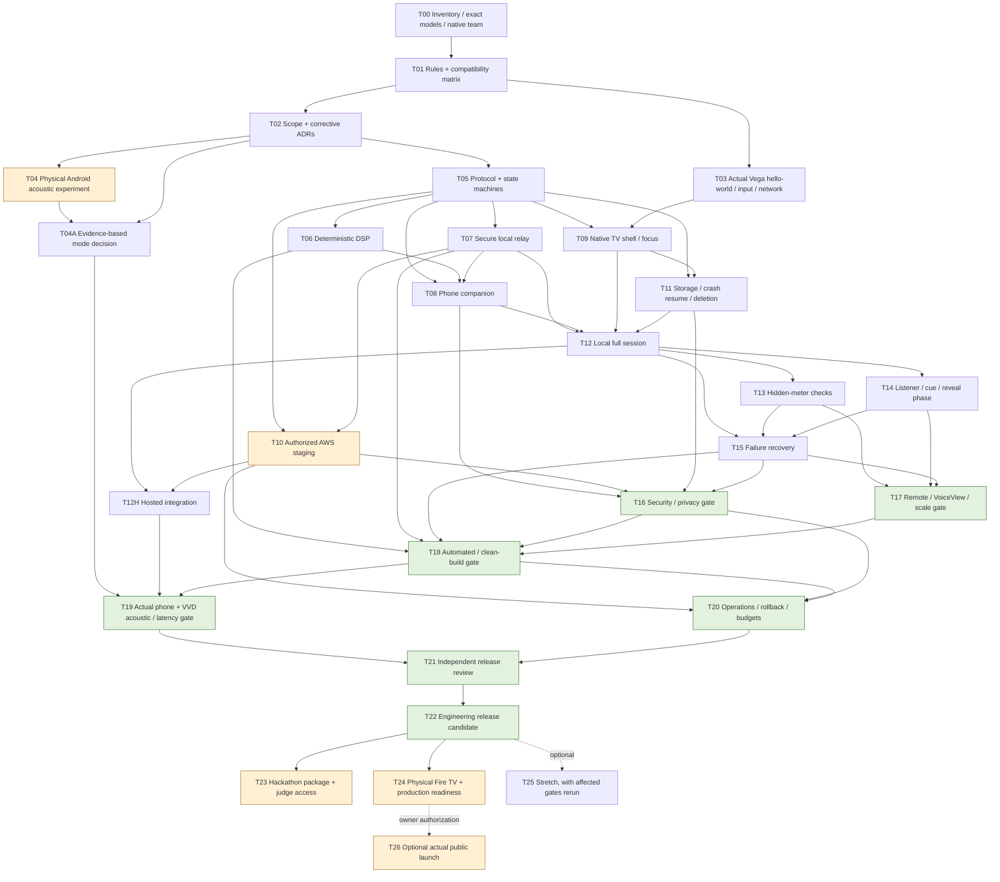
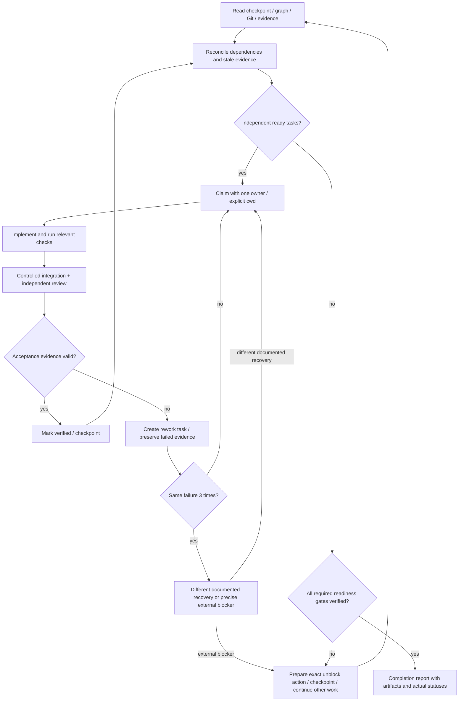

# Across the Room — complete build and verification graph

This is an **unexecuted plan**, prepared 5 October 2026. The [task graph](ACROSS_THE_ROOM_TASK_GRAPH.json) contains 29 unique tasks. It is a seed for the persistent runtime graph, not a record of passed tests.

## Dependency graph



Local phone/DSP/relay implementation can continue while physical testing or AWS access is unavailable. Required real evidence remains blocked until obtained. The hosted gate depends on AWS; the local build does not.

T04 is an honest experiment, not a requirement to falsify an AGC pass. T04A selects and validates relative-band mode or Listener Edition. The fallback still requires qualified timing/quality evidence; “AGC failed” does not automatically validate VAD.

## Evidence gates and meaning

| Gate | Minimum acceptable evidence | Cannot be replaced by |
|---|---|---|
| Toolchain/native slice | Pinned SDK/RN/OS matrix, actual VVD app render and input/network traces | Browser mock or documentation |
| Phone/sensor qualification | Physical Android settings, fixed geometry, randomized repeat trials and actual results | Mock getUserMedia or an expected compatibility result |
| Automated integration | Independent numerical, contract, E2E and failure tests on integrated commit | Teammate “done” message |
| Security/privacy | Role/room/expiry/abuse tests plus real network/log/data inspection | A privacy string in the UI |
| Accessibility | Observed remote flow, target scaling and supported screen-reader checks | Lint or screenshots alone |
| Engineering candidate, T22 | All required code, automated, actual phone/VVD, independent review and operations evidence | A scaffold, fixture demo or unit-test pass |
| Hackathon ready, T23 | Actual platform demo, complete current-rule materials and judge access; required final publication status is explicit | Draft links or private inaccessible source |
| Production ready, T24 | Real target Fire TV tests, support/distribution candidate, applicable certification resolution and operational signoff | Simulator-only evidence |
| Public launched, T26 | Owner-authorized accepted distribution/rollout and postlaunch evidence | A release ZIP or prepared store listing |

Amazon's [run guide](https://developer.amazon.com/docs/vega/0.24/run-apps) requires physical Fire TV testing before Appstore submission. The [Official Rules](https://amazonappdev2026.devpost.com/rules) separately accept a Vega simulator for the hackathon demo.

## Scheduler and repair loop



The conceptual return from an external blocker to A occurs **after new input, restored access or a resumed session**. It is not an instruction to busy-poll indefinitely. If no executable work remains, give a precise pending state, preserve the resume command and wait for the external change.

## Durable state and review

Canonical project artifacts: `.build/task-graph.json`, `.build/requirements.json`, `.build/evidence.jsonl`, `.build/checkpoint.md`, `.build/blockers.md`, `.build/decisions.md` and `.build/release-status.json`.

Every evidence record binds requirement/task, actual environment, command/observation, timestamp, integrated commit, expected/observed outcome, result and artifact hash/path. No secrets or full private payloads belong in those records.

Task states: pending, ready, in_progress, in_review, verified, rework, blocked_external, cancelled_optional. Only genuinely optional work can be cancelled. The native task list can use its supported coarse states while the repository keeps these richer states.

Integration or changed assumptions invalidates affected downstream evidence. Recheck that evidence before release. Keep an independent reviewer for the implementation owner's acceptance; security/QA findings create rework rather than disappearing into prose.

## Continuous work and resume

Use interactive native teams, exact model resolution and explicit Sonnet assignments. [Claude Code documents](https://code.claude.com/docs/en/agent-teams) experimental teams and session-resume limitations. Worktree isolation must be deliberately established; do not confuse ordinary Agent isolation with a native teammate.

At interruption, persist current SHA, changed files, owners, verified tasks, open failures, external blockers and next ready IDs. On resume, revalidate the checkout, respawn absent teammates and continue the graph. Do not claim the process runs when the host/session is offline.

Suggested resume message:

```text
Read research/ACROSS_THE_ROOM_OPUS_5_5_MASTER_PROMPT.md,
.build/checkpoint.md and .build/task-graph.json.
Reconcile actual Git/evidence state, respawn required Sonnet 5.5 teammates,
and continue all authorized ready tasks. Preserve failed/pending external
gates; do not restart completed work or invent results.
```

Native hooks are supplementary guards. Follow the current [hooks contract](https://code.claude.com/docs/en/hooks), reject task completion without evidence, keep callbacks bounded, and avoid endless Stop hooks. The durable graph remains necessary.

## Task catalogue

| ID | Work | Owner role | Dependencies |
|---|---|---|---|
| T00 | Inventory, model access and team setup | lead | — |
| T01 | Verify rules and dependency matrix | research | T00 |
| T02 | Freeze product scope and resolve ADRs | lead | T01 |
| T03 | Run Vega hello-world and network spike | vega | T01 |
| T04 | Run real Android microphone spike | audio | T02 |
| T04A | Decide and validate measurement mode | lead | T04, T02 |
| T05 | Freeze versioned protocol and state machines | contracts | T02 |
| T06 | Implement deterministic DSP package | audio | T05 |
| T07 | Implement secure local relay | backend | T05 |
| T08 | Implement phone companion | phone | T05, T06, T07 |
| T09 | Implement native TV shell and focus | vega | T03, T05 |
| T10 | Deploy and verify AWS staging relay | cloud | T05, T07 |
| T11 | Implement durable TV state and deletion | vega | T05, T09 |
| T12 | Integrate local full session loop | integrator | T07, T08, T09, T11 |
| T12H | Verify hosted full session integration | integrator | T12, T10 |
| T13 | Implement three blind checks | vega | T12 |
| T14 | Implement listener controls and agreement | phone | T12 |
| T15 | Implement failure recovery | integrator | T12, T13, T14 |
| T16 | Run security and privacy gate | security | T08, T10, T11, T15 |
| T17 | Run TV and phone accessibility gate | qa | T13, T14, T15 |
| T18 | Run automated integration and clean-build gate | qa | T06, T07, T15, T16, T17 |
| T19 | Run live device and acoustic gate | qa | T04A, T12H, T18 |
| T20 | Verify production operations | cloud | T10, T16, T18 |
| T21 | Independent adversarial release review | reviewer | T19, T20 |
| T22 | Create engineering release candidate | lead | T21 |
| T23 | Prepare complete hackathon package and judge access | release | T22 |
| T24 | Complete public-production readiness and distribution gate | release | T22 |
| T25 | Optional stretch after core release gates | integrator | T22 |
| T26 | Publish production release after owner authorization | release | T24 |

All tasks are pending in the supplied seed graph. No application runtime, deployment, acoustic/device test or certification was performed in this research task.
