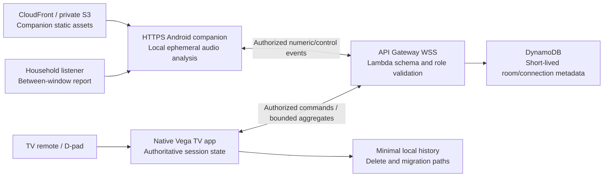
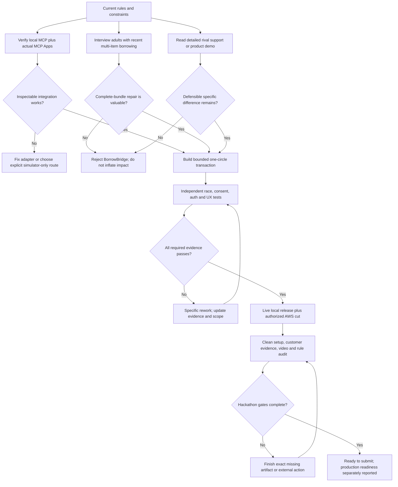

# Detailed category projects — 5 October 2026

Four alternatives, not four solo builds. Preferred conditional thesis: **Across the Room: Carryover Check**. Confirmed Mac-only alternative to qualify: **BorrowBridge**. This research pass did not qualify an application or customer/production claims; a separate active build is preserved and not certified here.

Read [the decision report](HACKATHON_REASSESSMENT_2026-10-05.md), [updated team prompt](OPUS_SONNET_REASSESSMENT_BUILD_PROMPT.md) and [task graph](REASSESSMENT_TASK_GRAPH.json).

Global corrections: Fire TV has **up to** three blind trials when the selected short session supplies them; never invent missing attempts. Speaker, listener and relative signal remain separate; known prompts bias listener reports. BorrowBridge atomicity is store-local; attach conditions to updates, and retain durable receipts beyond AWS ten-minute client-token idempotency. Ring privacy-zone exclusion and useful official-source variation must be proved. Bee requires genuine device data, local-only proxy and reconciliation of at-most-once streaming.

All applicable gates must pass. Diagrams illustrate flows; the JSON graph/evidence ledger governs readiness. Hours, sample targets and latency goals are proposals. Vendor pages establish advertised capabilities, not comparative effectiveness.

Each complete dossier includes alternatives, architecture, value/access gates, tests, demo, runtime/simulation boundaries and full sources.

## Fire TV reassessment: the strongest project is a conditional Carryover Check

**Research date:** 5 October 2026, Asia/Kolkata. **Status:** research and product specification; no application, device trial, customer interview or efficacy study was performed. This is the Fire TV angle of the current exhaustive cross-track reassessment.

### Decision

Of the five existing Fire TV ideas and the new alternatives tested in this pass, retain **Across the Room**, but recast it as **Across the Room: the Carryover Check**. The important product is a remote-controlled household practice session that separates **how the speaker thought it felt**, **whether the listener reports hearing it**, and **the relative signal reaching a stationary microphone**. A loudness meter, vowel timer, personal phrase bank and seven-day chart by themselves are already served by other products or straightforward adaptations.

This is the strongest differentiated Fire TV hypothesis in this evidence set, **not a proven winning idea**. It becomes a credible contender only if actual phone/Vega evidence and intended-user evidence survive the gates below. Its two serious weaknesses remain unqualified distant-phone measurement and unproven customer preference for this particular TV workflow. If those fail, do not rationalize them away with a larger agent team or a “production” label.

The earlier folder recommendation is useful analysis, but it overstates confidence when it calls the live wow “un-stageable”, implies a lack of visible entrants establishes originality, or treats lower estimated build effort as a reliable fact. The scorecard itself correctly discloses that its three judge lenses are model estimates, that its weighting differs from the actual rubric, and that FTV-3 slightly leads FTV-4 after red-team scores. None of those decimals predicts a prize.

### Official-rubric correction

The fresh [Official Rules](https://amazonappdev2026.devpost.com/rules) have **four equally weighted** Stage Two criteria: technology implementation, design, potential impact and quality of the idea. Tie resolution follows the order of those criteria. Feasibility is a practical decision gate, not an additional official weighted criterion. Stage One separately checks theme and required-technology viability.

Fire TV requires a demo-ready app working on Fire OS or Vega OS, with the video showing an actual Fire TV or Fire TV/Vega simulator. A browser-only mock does not satisfy that rule. Multimodal interaction is a creative example; this project's mapping of acoustic input, D-pad control and native visual feedback to that example is an inference, not an organizer endorsement. The rules do not require a generative model. A superficial AI add-on should not displace a reliable core. [Official Rules](https://amazonappdev2026.devpost.com/rules).

The project is eligible **only after it actually runs on the required environment**. Current Vega docs demonstrate available focus, network, SVG, persistence and accessibility interfaces; they do not prove that this project has built. Actual physical Fire TV testing is an additional Appstore release requirement even though VVD is accepted for the hackathon. [Focus](https://developer.amazon.com/docs/vega/0.24/focus-management), [Run/test guide](https://developer.amazon.com/docs/vega/0.24/run-apps), [pre-submission tests](https://developer.amazon.com/docs/vega/0.24/test-before-submission).

### Audit of the existing Fire TV ideas

| Existing concept | What survives | Why it is not yet a strong winning claim | Disposition |
|---|---|---|---|
| FTV-1 Story Night | Shared-photo storytelling and attribution of contradictory memories are a plausible group experience | Remento, Storyworth and StoryCorps already serve capture; the TV/group benefit is untested; original estimate is 140 solo hours; transcription, consent, recording, archiving and media playback add scope | Keep as a future team project, not the current solo choice |
| FTV-2 WordGlow TV | Word-level remote interaction and deterministic generation constraints are coherent | Easy to perceive as the rules' obvious video-player category; evidence for same-language subtitling does not validate the new AI-story intervention; child-content review and adaptive content pipeline add risk | Do not choose without a compelling TV-specific child/parent test |
| FTV-3 Mail Check | Remote capture and source-region evidence are useful; excellent measurable OCR/geometry engineering | Apple's current Magnifier already captures documents, customizes/reflows text, reads aloud and answers a bill-total question; rival/entrant overlap remains high; low-vision TV preference and reliable capture untested | Strong technical runner-up, weaker differentiated thesis |
| FTV-4 Across the Room | Far listener geometry, remote operation and separate subjective listener feedback are a defensible product hypothesis | Free phone biofeedback/functional practice already exists; level is not intelligibility; actual distant-phone behavior and demand missing; expanded estimate leaves almost no slack | Retain only with redesigned core and falsification gates |
| FTV-5 Measure by Measure | Native remote loops plus phone-note synchronization can demonstrate technical work | Score Wizard now explicitly advertises hands-free score following and automatic page turning for arbitrary PDF scores, Mac/iPad, pedal/gesture/eye-blink control; Yousician/Simply Piano add listening instruction; prior originality confidence was too high | Drop from the top rank |

The table combines fresh sources below with the existing local scorecard/specifications. It does not claim every rival was installed. Vendor pages establish advertised overlap; they do not establish comparative quality, clinical benefit or complete feature absence.

#### Named-rival findings that change the decision

1. **Loud and Clear is a serious direct rival.** Its current [App Store listing](https://apps.apple.com/us/app/loud-and-clear/id1491171131) describes phone/tablet microphone biofeedback, volume and pitch warm-ups, then functional everyday speech practice. It is free. Its developer replies to a user review saying manual progression will be incorporated; a review is not a confirmed current capability, but it means user-paced progression is not a durable moat. The [voice-fitness page](https://loudandclear.io/parkinsons-voice-fitness/) contains older warm-up examples; its webinar schedule is undated historical content and is not evidence of a current 2026 schedule.
2. **Speak Up already has phrases and free-form practice.** Its [App Store listing](https://apps.apple.com/us/app/speak-up-for-parkinsons/id784117908) describes words/phrases, reading/conversation, volume meter and audio/video feedback. Reviews complain about target volume, phrase repetition and microphone permissions, but these are individual, possibly old anecdotes, not a verified current failure rate. Household phrases, actual permission-state recovery and user-paced operation can answer such friction; they are execution advantages rather than a new market.
3. **Voicibel already implements a target-range meter.** Its [listing](https://apps.apple.com/us/app/voicibel/id6444749376) advertises setting a range and speaking into it. The developer declares no data collection; Apple explicitly says privacy declarations are not independently verified. “No audio upload” alone cannot justify originality.
4. **Mail Check's main AI/OCR task is available natively elsewhere.** Apple's [current official Magnifier guide](https://support.apple.com/guide/iphone/magnify-information-iphe867dc99c/ios) describes Ask Magnifier with a bill-total example, document/multi-photo capture, Reader formatting and read-aloud. Feature availability depends on supported hardware, OS, language and region. The precise TV remote/source-crop workflow can still differ, but “read a bill for someone with low vision” is not the novel thesis.
5. **Measure by Measure faces a stronger score-following rival than the previous pass established.** [Score Wizard](https://apps.apple.com/no/app/score-wizard/id1438151717) now describes real-time automatic page turning and a cursor following arbitrary PDF scores, with Mac/iPad, pedals, gestures and eye-blinks. The search result carried a misleading “iOSTV” fragment; the inspected listing identifies **iPad and Mac**, not Apple TV. Do not repeat the search fragment as platform proof.
6. **A new shared-caption TV idea also collides.** [Ava](https://www.ava.me/) advertises real-time conversation captions, speaker attribution, transcripts and summaries. [Live Caption](https://apps.apple.com/us/app/live-caption/id955278049) appeared in search with an explicit Apple TV larger-display description; only its snippet was read in this pass. That is a named overlap warning, not a full product audit. A “family captions on TV” pivot therefore needs a more substantial mechanism than casting captions.

### Three strengthened/new candidates

| Candidate | Core mechanism | Judge-visible proof | Main failure condition | Decision |
|---|---|---|---|---|
| **Across the Room: Carryover Check** | Separate speaker perception, listener report and qualified per-session level; hide the meter during selected trials; TV remote controls timing and reveal | One unedited live session showing a genuine disagreement and no false success after noisy input/disconnect | Intended users do not prefer/need it; phone behavior cannot qualify; result wording implies comprehension | **Best current Fire TV hypothesis** |
| **Mail Check: Evidence Desk** | Remote shutter, large source image, four extracted fields, geometry-backed “show me”, explicit uncertainty and user confirmation; no freeform model conclusions | Deliberately ambiguous date returns uncertainty; remote zooms the exact crop and the user confirms | Current native/rival reader is as good; capture quality/accuracy fails; no intended-user benefit | Reserve alternative if phone measurement fails early and OCR path proves itself |
| **Caption Circle: Shared Turn Board** | Each participant's nearby phone supplies a separately attributed caption stream; remote pins/corrects/replays text and mediates turns; no automatic speaker identity | Overlapping inputs remain attributed, late corrections update the right text and a hard-of-hearing user controls pace | Ava/phone mirroring provides equivalent value; multiple microphones/consent become cumbersome; cloud ASR latency dominates | Novel candidate tested by rival search; **do not select** under current solo constraints |

“Carryover” here names transfer from screen-directed practice to a household phrase without visible meter feedback. It does not claim a clinical outcome. No reviewed vendor source established the exact three-part TV/far-microphone/listener workflow. That is a bounded research result, **not evidence that nobody has built it**.

### Detailed selected-project specification

#### One-sentence pitch

**Across the Room lets a household practise the phrases they actually say from one side of the living room to the other, using the TV remote, and shows speaker perception, listener response and relative sound as three separate pieces of feedback.**

#### Initial user and concrete job

An adult with an existing clinician-provided home practice plan and a consenting household listener can practise their own short phrases without holding or watching the microphone phone. The TV provides large prompts, predictable pacing and shared results. A household without a clinician plan may demonstrate ordinary communication practice; the app must not generate a treatment schedule or advise maximal effort.

The primary testable job is **making a shared practice routine usable and informative**, not diagnosing dysarthria, treating Parkinson's, measuring calibrated SPL, detecting the intended speaker, or establishing speech comprehension. Regulatory classification is not settled by a disclaimer; public deployment requires the appropriate intended-use/privacy/distribution review.

#### Core product: keep six capabilities

1. **Native TV setup and remote focus.** Large instructions, code/QR pairing, start/pause/retry/skip/finish, predictable Back, visible focus and screen-reader support. Prove this on VVD.
2. **One stationary phone.** Secure HTTPS page, explicit microphone consent, track settings, capture lifecycle and a marked position beside the TV. Listener controls unlock between capture windows, so microphone handling does not contaminate those windows. The speaker never needs to touch the phone after setup.
3. **A short quality/precheck stage.** Quiet-window aggregate, per-session calibration when the qualified phone mode supports it, and clear invalid/noisy/clipped/interrupted states. Never convert noise into success.
4. **User-paced household phrases.** One to ten original phrases, literal rendering, capped lengths, remote-controlled start/stop and no forced timed advancement.
5. **Three blind/reveal trials.** At applicable phrase positions 3/6/9, hide all meter output and accessible result leaks. Speaker rates Felt loud/Felt normal/Skip. Listener separately taps Heard/Not heard/Skip. Reveal only after the required responses or an explicit user skip. Lock the attempt and exclude late/missing responses from the primary denominator. A listener report is subjective; knowing the phrase beforehand can bias it, so never call this an intelligibility test.
6. **A truthful summary.** Counts with attempted/eligible denominators; separate visible and blind results; quality failures; actual dated history; deletion/unpair; independent indicators for microphone open, actively measuring and connection unknown. Do not show invented histories.

The far-side level is **supporting evidence** after qualification, not the sole success metric. If the browser/device cannot support a defensible relative-band claim, keep listener responses and perception as the primary loop, label any surviving arc as relative/within-session, and remove unsupported comparisons. If even that loop fails user preference, stop the concept rather than calling the fallback a validated product.

#### Solo entrant and unconfirmed equipment: explicit applicability

**A solo developer can implement this, but the complete listener-first experience requires a second consenting human during a session.** An AI agent, the speaker responding for the listener, or a prerecorded listener tap cannot supply independent human feedback. The listener can be a household member or healthy volunteer for a labelled technical demo; that does not establish intended-user value.

| Available at implementation time | What can honestly be delivered | Recommendation |
|---|---|---|
| Mac/VVD only; no confirmed phone or listener | Native shell, typed transport and labelled numeric fixture replay | Not the full project; do not rank it the unconditional overall choice |
| Mac/VVD plus qualifying Android; no listener | A real relative-level practice mode and self-perception checks | Loses the main differentiated listener loop; weaker contender than the selected core |
| Mac/VVD, qualifying Android, second healthy consenting volunteer | Complete real technical demo with limited user-validation evidence | Plausible Fire TV build choice if intended-user value can also be investigated |
| Above plus intended-user household access and qualified professional review | Technical proof plus credible formative impact evidence | Strongest case for committing to this thesis |
| Above plus supported physical Fire TV | Adds actual hardware/lifecycle/accessibility testing | Helps release readiness; store/distribution and any applicable reviews still remain |

A household listener responding on the one stationary phone must reach its controls **between closed capture windows**. Practical positioning, viewing the TV and whether touching that phone becomes burdensome require observed testing. These constraints cannot be removed by promising a larger coding team. If borrowing an Android and finding a listener cannot be confirmed immediately, favor a category finalist whose complete primary experience genuinely runs with the available Mac and supported simulated track path.

#### Deliberate scope cuts

Remove pitch glides, autonomous target increases, cross-day loudness comparisons, clinician-like instructions, prescribing duration/rest, raw recordings, cloud speech recognition, generative “coaching”, a third phone, arbitrary notifications and polling fallback from the first core. A user-provided optional vowel/duration exercise may be added after timing/clinical framing review, but is not needed for the decisive demo. Keep caregiver export optional. Use WSS plus a documented local relay; add polling only if required by observed transport failure and its retention/security/cost design is complete.

This cut is essential: the prior feature-added estimate was roughly 102.5 hours against a roughly 104-hour solo budget. These are unmeasured estimates. Adding parallel coding agents does not remove independent device, user, integration and release work.

#### Architecture and Amazon integration



Native Vega is responsible for remote navigation, focus restoration, accessible presentation, results/reveal state and local history. Its role must be visible in the demo; do not hide the product inside a generic web view. Current official docs support focus, network, SVG and accessible properties. [Focus](https://developer.amazon.com/docs/vega/0.24/focus-management), [network](https://developer.amazon.com/docs/react-native-vega/0.83/network), [SVG](https://developer.amazon.com/docs/vega-api/0.24/react-native-svg), [accessibility](https://developer.amazon.com/docs/react-native-vega/0.83/accessibility).

Audio samples stay local and ephemeral. Send only bounded numeric aggregates/levels, event IDs, lifecycle observations and intentionally entered phrases/responses. Do not say “only numbers leave” because phrases, responses, tokens and control metadata also cross the network. HTTPS is required for normal microphone access; a LAN HTTP URL is not equivalent. Requesting AGC off and reading settings is not proof of an unprocessed microphone. [getUserMedia](https://developer.mozilla.org/en-US/docs/Web/API/MediaDevices/getUserMedia), [AGC](https://developer.mozilla.org/en-US/docs/Web/API/MediaTrackConstraints/autoGainControl), [waveform access](https://developer.mozilla.org/en-US/docs/Web/API/AnalyserNode/getFloatTimeDomainData).

Use short-lived credentials separate from the room code, TV confirmation, bound sender roles, per-message authorization, monotonic producer generation/sequence, attempt/window IDs, logical expiry, bounded payloads and idempotency. API Gateway connection authorization does not authorize every later application action. DynamoDB TTL is cleanup and not instant revocation. Minimal local summaries may still be sensitive; Vega AsyncStorage is unencrypted. [WebSocket authorizers](https://docs.aws.amazon.com/apigateway/latest/developerguide/apigateway-websocket-api-lambda-auth.html), [TTL](https://docs.aws.amazon.com/amazondynamodb/latest/developerguide/TTL.html), [Vega storage](https://developer.amazon.com/docs/vega-api/0.24/react-native-async-storage).

#### The three-minute demo

**0:00–0:20:** Show the concrete living-room geometry and who does what. State plainly that this is an actual VVD/native demo and the person is a developer volunteer. Show the far phone position and use only original household phrases.

**0:20–0:45:** Pair and grant microphone consent. Show actual live state after permission. Finish a short precheck and state the supported per-session measurement mode.

**0:45–1:30:** Run a visible trial and a blind trial with the real microphone. Speaker rates how it felt, listener answers independently, then TV reveals both and the separate relative-level result. A disagreement is interesting without claiming that the machine knows who is right. Use real outcomes, not rehearsed required values.

**1:30–1:55:** Trigger a real phone disconnect or controlled noisy input. The current window is cancelled/unscored, focus moves to a useful recovery action and a fresh explicit start is required. This makes robustness legible.

**1:55–2:20:** Show summary denominators and deletion/microphone shutdown. Include a compact actual measured latency/quality result, with device and evidence class. Do not linger on logs or internal architecture.

**2:20–2:55:** Explain the verified user observation, limitations, native Vega role, concise cloud diagram and reusable open-source contribution. End with the finished experience, not an architecture pitch replacing it.

This is a proof of working behavior, not proof of clinical benefit or universal market demand. If only healthy volunteer testing exists, label it accurately.

### Falsification and acceptance gates

#### Gate A: native feasibility, by the first build day

Build official Hello World with one pinned SDK/RN/package line; launch the VPKG on VVD; run an actual D-pad flow; connect securely to a minimal relay. No browser preview substitute. Current SDK docs mention Rosetta and compatible RN lines; recheck installed host state. [Install](https://developer.amazon.com/docs/vega/0.24/install-vega-sdk), [compatibility](https://developer.amazon.com/docs/vega/0.24/target-os-version), [Hello World](https://developer.amazon.com/docs/vega/0.24/hello-world).

**Stop/route elsewhere if the required native environment cannot actually run within the fixed setup budget.** A paper plan is not Fire TV eligibility.

#### Gate B: physical-phone validity, before meter scoring is enabled

Record exact Android device/browser/input/constraints/settings. Freeze the test protocol and thresholds before results. Use randomized repeated controlled digital-amplitude stimuli at the actual marked geometry, real speech, clipping, gaps and negative/noise cases. Digital stimulus steps are not calibrated SPL. Report distributions and limitations. Verify track shutdown, background behavior and capture indicator.

**If relative output is flattened or unreliable, disable relative-band verdicts.** If voice-activity timing fails ground-truth agreement, disable that metric too. A listener-first mode does not cure false VAD or turn an AGC setting into evidence.

#### Gate C: TV-specific user value, before full implementation

Seek two intended-user/household dyads and one qualified speech-language professional if access is feasible. This is formative usability, not an efficacy trial. Compare the TV/marked far phone workflow against a current phone app with equivalent prompts; counterbalance order and document assistance needed, setup friction, successful remote steps and stated reasons. Observe whether the blind/reveal distinction actually changes a household conversation or simply confuses users.

**Reversal rule:** if both dyads prefer the phone alternative for the claimed job and no concrete TV advantage is observed, do not select this thesis. If only healthy volunteers are available, report Gate C as limited/pending rather than passed for the target population. Avoid disguising clinician access as required authorization for ordinary coding; it is evidence needed for the impact claim.

#### Gate D: independent technical evidence

Automated numerical fixtures with independently calculated expectations; role/room/window/replay security tests; actual permission/lifecycle tests; native remote/accessibility journey; hidden-result leaks including phone/UI/VoiceView; out-of-order/disconnect/expiry recovery; no-audio network/storage/log inspection; actual deletion. Measure latency with an independent clock/camera observation rather than treating a network RTT as full display latency.

Keep fixture replay, real phone, actual VVD and physical Fire TV evidence separate. No implementation owner self-certifies the release gate. Every pass records build/commit/device/timestamp/expected/observed/artifact.

#### Gate E: complete submission and separately labelled release

Prepare functional code/assets/setup, clean reproducible build, public English video under three minutes, required SDK/tool feedback and genuine friction entries. Maintain free judge access through the official judging end and recheck all amendments. A hackathon-ready VVD candidate is different from a physical-device-tested Appstore-ready public release. [Official Rules](https://amazonappdev2026.devpost.com/rules), [Vega release testing](https://developer.amazon.com/docs/vega/0.24/test-before-submission).

### Build sequence and team responsibilities

This is an implementation recommendation, not a promise that the project is production-ready in eighteen days.

1. **Lead/integrator:** own current rule ledger, chosen scope, compatibility decision, graph, evidence and shared manifests. Begin with feasibility/measurement/value gates; never schedule cosmetic polish ahead of them.
2. **Vega teammate:** actual native shell, focus, session/reveal UI, accessibility, persistence and state recovery.
3. **Companion/DSP teammate:** local reference relay, secure microphone page, numerical calculations, timestamps/lifecycle and observed phone qualification.
4. **Backend/security teammate:** versioned contracts, credential/role/window checks, cloud transport, redaction, deployments and operational recovery. Can rotate after contracts are established to respect concurrency limits.
5. **Independent reviewer:** acceptance tests, actual device observations, result-leak/abuse cases, source verification and submission checks. A role can be staffed sequentially; an agent count is not human/team validation.

Use a dependency graph with `feasibility → contract → parallel TV/phone/relay → integration → blind/listener phase → recovery/security/accessibility → independent device/user gates → release/submission`. Failed gates reopen affected tasks; external hardware/user/account blockers stay explicitly pending while independent work continues. Preserve commits, paths, evidence and resume instructions. This is more useful than a loop that endlessly retries the same failed build.

Suggested allocation within the available window: first 1–2 days feasibility and formative evidence; next 5 days local vertical slice; next 3 days blind/listener/recovery integration; next 3 days cloud/accessibility/security and independent device evidence; last 3–4 days defect repair, clean setup and submission reserve. This is a planning estimate, not measured capacity. If Gates A–C are not settled early, do not consume the reserve with scope additions.

### Mini-challenge strategy

**Open Source:** the strongest secondary artifact is a separately useful **Vega remote-session kit**: native TV focus/recovery patterns, secure phone pairing, typed attempt/window protocol, a reference companion adapter, fixture transport and tests demonstrating stale-result/hidden-reveal safety. Make it usable independently of the practice app, clearly licensed, documented and published according to the current additional contribution requirements. A generic arc component or typo/README change is a weaker contribution. Current rules specifically reward substantive tested features or new integration patterns. [Official Rules](https://amazonappdev2026.devpost.com/rules).

**AWS Builder:** API Gateway/Lambda/DynamoDB/S3/CloudFront are purposeful support, but that service list alone is a modest creative story. The rules now explicitly allow Kiro Crew development to qualify without runtime AWS; choose an honest documented development workflow and runtime evidence when used. Do not add AgentCore/Bedrock to deterministic scoring merely to decorate the diagram. Publish an actual adversarial test/contract-development workflow and authentic friction log if it exists. Eligibility is not the same as mini-challenge competitiveness. [Official Rules](https://amazonappdev2026.devpost.com/rules).

### Source inventory and quality

Fresh retrieval was through Firecrawl CLI 1.23.3, eight searches and eight primary page scrapes. Initial Loud and Clear/Speak Up requests hit the shared 12-request/minute rate limit and were retried; successful outputs were inspected. All new raw files belong under `.firecrawl/reassessment-oct5/ftv-*`. Fresh platform/audio/cloud bodies retrieved earlier on **5 October** are reused from `.firecrawl/across-room-oct5/` rather than fetched again. Root's live rules/gallery/resource refresh is reused. The project gallery remains unpublished in the current root retrieval, so private competition is unknown.

| Source | URL | Quality/use and raw file |
|---|---|---|
| Current rules | https://amazonappdev2026.devpost.com/rules | Official governing requirements; root retrieval `event-rules.md` |
| Current Vega focus | https://developer.amazon.com/docs/vega/latest/focus-management.html | Official page redirects to 0.24; APIs and visible focus; `ftv-focus.md` |
| Loud and Clear store | https://apps.apple.com/us/app/loud-and-clear/id1491171131 | Primary advertised capabilities; user reviews anecdotal; `ftv-loudclear-store.md` |
| Loud and Clear fitness page | https://loudandclear.io/parkinsons-voice-fitness/ | Vendor historical exercise/webinar content, no independent benefit evidence; `ftv-loudclear.md` |
| Speak Up store | https://apps.apple.com/us/app/speak-up-for-parkinsons/id784117908 | Primary advertised features; reviews not a current failure-rate study; `ftv-speakup.md` |
| Voicibel store | https://apps.apple.com/us/app/voicibel/id6444749376 | Primary target-meter overlap; privacy self-declaration; `ftv-voicibel.md` |
| Apple Magnifier | https://support.apple.com/guide/iphone/magnify-information-iphe867dc99c/ios | Official current iOS27 guide; availability limited by model/region/language; `ftv-magnifier.md` |
| Score Wizard | https://apps.apple.com/no/app/score-wizard/id1438151717 | Primary advertised score-following overlap, no performance verification; `ftv-scorewizard.md` |
| Ava | https://www.ava.me/ | Primary conversation-caption overlap, vendor accuracy claims not independently verified; `ftv-ava.md` |
| Live Caption | https://apps.apple.com/us/app/live-caption/id955278049 | Search snippet only; TV-casting overlap warning; `ftv-search-group.json` |
| Official native sample | https://github.com/AmazonAppDev/vega-tv-interfaces-sample | Reused current official project body; build still unexecuted; `platform-tv-sample.md` |
| Vega install | https://developer.amazon.com/docs/vega/0.24/install-vega-sdk | Reused 5 Oct primary body; host/toolchain prerequisites; `platform-install.md` |
| Vega compatibility | https://developer.amazon.com/docs/vega/0.24/target-os-version | Reused 5 Oct primary body; choose one proven version line; `platform-matrix.md` |
| Vega Hello World | https://developer.amazon.com/docs/vega/0.24/hello-world | Reused 5 Oct primary body; first native gate; `platform-hello-world.md` |
| Vega networking | https://developer.amazon.com/docs/react-native-vega/0.83/network | Reused primary API reference, not runtime proof; `platform-network.md` |
| Vega SVG | https://developer.amazon.com/docs/vega-api/0.24/react-native-svg | Reused primary supported primitives/exclusions; `platform-svg.md` |
| Vega accessibility | https://developer.amazon.com/docs/react-native-vega/0.83/accessibility | Reused primary assistive APIs; observed testing still required; `platform-accessibility.md` |
| Vega persistence | https://developer.amazon.com/docs/vega-api/0.24/react-native-async-storage | Reused primary unencrypted-storage warning; `platform-storage.md` |
| Vega run/test | https://developer.amazon.com/docs/vega/0.24/run-apps | Reused primary VVD/physical device distinctions; `platform-run-apps.md` |
| Vega pre-submission tests | https://developer.amazon.com/docs/vega/0.24/test-before-submission | Reused primary release/lifecycle requirements; `platform-test-before-submission.md` |
| Microphone access | https://developer.mozilla.org/en-US/docs/Web/API/MediaDevices/getUserMedia | Reused primary API/secure-context reference; `audio-getusermedia.md` |
| Gain constraints | https://developer.mozilla.org/en-US/docs/Web/API/MediaTrackConstraints/autoGainControl | Reused primary request/support semantics, no measurement qualification; `audio-autogaincontrol.md` |
| Local waveform analysis | https://developer.mozilla.org/en-US/docs/Web/API/AnalyserNode/getFloatTimeDomainData | Reused primary digital-waveform semantics, not SPL/intelligibility; `audio-analysernode.md` |
| API Gateway authorizers | https://docs.aws.amazon.com/apigateway/latest/developerguide/apigateway-websocket-api-lambda-auth.html | Reused AWS primary connection-level semantics; `aws-auth.md` |
| DynamoDB TTL | https://docs.aws.amazon.com/amazondynamodb/latest/developerguide/TTL.html | Reused AWS primary asynchronous cleanup semantics; `aws-ttl.md` |

#### Research limits and rerun inputs

No full patent landscape, installed-rival test, actual clinician interview, target-user preference, acoustic accuracy, live latency or build verification was performed. Supply-side feature absence in a reviewed page is not verified product absence. No medical outcome or “winning probability” is estimated. Prior folder scores and solo-hour estimates are analyst hypotheses, not official judging data.

```text
workflow: firecrawl-deep-research
topic: Reassess all local Fire TV ideas against current rules, platform proof, direct products and strengthened alternatives
depth: exhaustive cross-track report; this angle eight searches/eight new primary scrapes plus fresh 5 Oct reused official bodies
output: research/_working/reassessment_firetv.md
queries: ftv-search-farfield, mail, group, music, speech-products, score-tv, tv-access, family-new
next decision: actual Gates A/B/C before committing the remaining build window
```

---

## Alexa+ track reassessment: BorrowBridge, with a hard novelty gate

**Researched:** 5 October 2026, Asia/Kolkata. **Scope:** solo India-based builder on the existing Mac; Echo, Android, Bee and physical Fire TV access unconfirmed. This is the Alexa+ contribution to the exhaustive four-track reassessment. **Status:** research and proposed specification only. No customer interviews, rival installs, product implementation or measured performance were completed. No win is guaranteed.

### Executive judgment

The earlier folder contains plausible proposals, not demonstrated winning projects. For Alexa+, I would not keep OutPass as the unconditional winner. Its verified residue is a child-initiated permission state machine with conditions; its ambient-device entry point, child attribution and notification delivery are simulated, and the customer need for a permission desk rather than a call or watch is untested. ClearPlate should remain rejected: the documented native allergy/preference memory and the previously identified Belay sharing product shrink its originality, while medical/allergy decision and child-supervision claims add risk without an accessible live Alexa integration.

**Best new Alexa+ candidate under these constraints: BorrowBridge — “Ask for the whole setup. Reserve it only when everybody agrees.”** It coordinates borrowing a low-risk event bundle from a private adult circle. One request becomes a bounded plan across multiple owners, resolves a conflict by changing a time or an acceptable item, gathers authenticated owner consent, then commits all reservations together or none. A real MCP server, real MCP Apps interface, real durable consent and concurrency checks run behind a clearly labelled independently built Alexa-style simulator.

This is a **conditional recommendation**, not a verified market gap. Lending itself, item bundles, reminders and reservations are already shipped. Lend Engine explicitly lets users reserve one or more items in a calendar and use a cart. The proposed wedge is cross-owner negotiation, immutable revision-bound consent, and preventing a “partial kit” after a race or decline. Those exact features were **not verified** in the reviewed myTurn/Lend Engine pages; that is not proof competitors lack them. If lending organizations or adult borrowing circles do not value the wedge, do not build a polished generic borrowing catalog and call it novel.

### 1. What the current official evidence allows

1. The current Official Rules permit a self-hosted MCP server implementing at least spec 2025-11-25 over Streamable HTTP, and also permit an independently built simulated Alexa+ experience; the simulation exemption does not require a specific MCP-shaped surface. We should nevertheless implement genuine MCP because its lifecycle, tool contracts and Apps UI can become inspectable technical evidence. [Official Rules](https://amazonappdev2026.devpost.com/rules), fresh shared save: `.firecrawl/reassessment-oct5/event-rules.md`.
2. Stage Two uses four equally weighted criteria: Tech Implementation, Design, Potential Impact and Quality of the Idea. The old folder’s five-factor weighted feasibility model is an internal planning model, not Amazon’s rubric. The Alexa+ examples distinguish a basic API wrapper from stateful agentic workflows, rich media, MCP Apps and Agent Skills. [Official Rules](https://amazonappdev2026.devpost.com/rules).
3. Amazon publicly states that Category SDK and MCP Toolkit are available to select partners. Toolkit geography is the United States. A solo entrant in India must not present public docs as proof of partner access. [Alexa+ documentation home](https://developer.amazon.com/docs/alexaplus/add-ons/home.html), [MCP Toolkit overview](https://developer.amazon.com/docs/alexaplus/add-ons/mcp-toolkit-overview.html).
4. Amazon’s overview explicitly documents MCP 2025-11-25 support and MCP Apps. Its lifecycle sample still uses 2025-03-26. Target 2025-11-25 and test compatible negotiation if the selected SDK supports it; do not infer the actual gated client’s behavior from a sample or introduce an unconfirmed later protocol as the sole build target. [Toolkit overview](https://developer.amazon.com/docs/alexaplus/add-ons/mcp-toolkit-overview.html), [client lifecycle](https://developer.amazon.com/docs/alexaplus/add-ons/mcp-toolkit-client-lifecycle.html).
5. MCP Apps is an interactive sandboxed UI extension: tool descriptions refer to a ui:// resource; the host fetches/render it and forwards UI tool calls. A custom browser component displaying a JSON result is not by itself proof that the MCP Apps protocol was implemented. [MCP Apps overview](https://modelcontextprotocol.io/extensions/apps/overview).
6. Amazon’s certification requirements emphasize stable identifiers, end-to-end transactions, cross-device continuity, explicit confirmation for consequential actions and duplicate prevention. Use these as design/test criteria without claiming certification. [Functional requirements](https://developer.amazon.com/docs/alexaplus/add-ons/functional-requirements.html).
7. Amazon already markets personal/document memory, calendar/email management, grocery ordering, restaurant reservations, voice-created routines and dietary-preference-based cooking support. “Alexa remembers X,” “turn a document into a calendar,” “plan dinner,” or “wrap one API” must earn their originality through a more specific mechanism. Marketing establishes advertised capability, not its quality in practice. [Alexa+ top features](https://www.aboutamazon.com/news/devices/new-alexa-top-features).

The broader report must retain the shared rule review for eligibility, deadline, code/license, video, judging access, track/mini-prize restrictions and friction-log evidence. This note does not replace that review.

### 2. Reassessment of the older Alexa concepts

| Older concept | Judgment | Why |
|---|---|---|
| ALX-5 OutPass | Plausible engineering demo; not a proven winner; demote | Requires a child/parent/host-family network and adoption argument that has not been tested. Actual voice attribution, Alexa notifications and Kids behavior are not publicly accessible in this build. The old rival audit already found Apple Watch/iPhone Check In, kid home phones and two visible family check-in/errand MCP projects. Its conditions and atomic ladder cancellation need to be shown as the residue, not check-in/approval as new. |
| ALX-4 ClearPlate | Keep rejected | Native Alexa preference/allergy recall and Belay caregiver-sharing collide. A deterministic refusal does not establish safe allergy advice or clinical value. Remove medical/emergency decision claims rather than dressing them with disclaimers. |
| ALX-3 ClaimTrail | Keep rejected as currently framed | The prior Brelly product/help reads found claim expenses, polished expense reports, estimate comparisons and reviewed external actions. Another evidence ledger is insufficient. Read actual help/product pages, not just homepages, before reopening it. |
| ALX-2 RideBook Access | Do not reopen without access and user evidence | Public real-service booking access was an earlier blocker. A simulated ride or accessibility promise cannot substitute for provider support. Routine ride booking is already an advertised Alexa category. |
| ALX-1 CarpoolMend | Not selected | Repairing a plan through consent can be useful, but driver/location/child-transport assumptions and calendar coordination create substantial validation work. The new candidate keeps the reversible coordination mechanism in a lower-stakes adult borrowing workflow. |

The old-concept facts above are synthesis of the local `IDEA_SCORECARD.md`, `RECOMMENDATION.md`, `spec_ALX-5.md`, `rivals_home.md` and `TRENDS_AND_RIVALS.md`. Existing rival citations: [Apple iPhone Check In](https://support.apple.com/guide/iphone/use-check-in-iphc143bb7e9/ios), [Apple Watch Check In](https://support.apple.com/guide/watch/use-check-in-apd7f329202c/watchos), [Ring Ring Club](https://ringringclub.com/), [daybreak](https://github.com/danielhagever/daybreak), [otsukai-mcp](https://github.com/shoujiki-panman/otsukai-mcp), [Brelly product](https://brelly.com/product/), [Belay](https://apps.apple.com/ca/app/belay-manage-food-allergies/id1303851165). **These were read in the previous research, not freshly re-scraped in this reassessment.** Current competitor changes remain possible. Repo READMEs are self-description, not independent proof of operating product quality.

### 3. Three new candidates and the choice

| Candidate | Specific proposed mechanism | Why it could fit | Main reason to reject |
|---|---|---|---|
| **BorrowBridge** | A private adult circle lends a complete event bundle across multiple owners; proposed time/item changes need revision-bound consent; one-store commit reserves all resources or none | Visible transactional wow; low hardware dependence; actual MCP Apps; state across sessions; deterministic constraint and concurrency tests | Catalogs, carts, multi-item reservation and reminders are already common. Cross-owner consent/repair demand is unverified. Alexa adds a conversational entry point but is not uniquely necessary. |
| **CoverShift** | For noncritical adult community event duties, an absent volunteer proposes a swap; outgoing/incoming volunteers and organizer explicitly accept; a failed acceptance leaves the original assignment intact | Clear plan-repair story and auditable state | Lotsa already supports cancellation/reassignment and group coordination. SignUpGenius and roster products are direct rivals; another task/calendar assistant has weak originality without a genuinely better repair mechanism. |
| **RoomReset** | Shared adult event-space reservation changes room, equipment and cleanup assignment as one approved local plan; explains which constraint caused a rejection | Bounded scheduling and tangible user interface | Existing booking/approval products are likely strong; institutional access and rules are harder to obtain and validate solo. One-store reservation guarantees would not apply to external facility systems. |

Freshly searched primary evidence for the alternatives includes [Lotsa Helping Hands](https://lotsahelpinghands.com/), [coordinator introduction](https://www.lotsahelpinghands.com/help/pe_intro_coordinators.html) and [How it works](https://caregiver.lotsahelpinghands.com/how/). Search excerpts show task cancellation/reassignment; they are not a full current feature audit.

**Selection: BorrowBridge, if the two-day customer/competitor gate passes.** It makes the most inspectable lower-risk technical artifact with unconfirmed hardware. Do not portray it as globally original or claim the other tracks cannot beat it. The comparison is an engineering/product judgment under the stated constraints, not a calibrated prediction of judge scores.

### 4. BorrowBridge product specification

#### Customer and problem

Adults in one trusted community—friends, apartment neighbors or a club—share low-risk event items: a board game, a folding-chair set, a cooler or a small speaker. An organizer needs a complete setup for a specific time. Separate “yes” messages can arrive for different times, owners can change their mind, and a late conflict can leave only part of the setup available. That exact coordination problem is a **hypothesis**; existing lending products verify the category, not this pain or its frequency.

Suggested pitch:

> “You do not need a reminder that someone has a chair. You need a complete, agreed setup for Saturday. BorrowBridge finds a workable bundle, asks each owner, and reserves it only when every approval still applies.”

Avoid quantified money/carbon savings, “most households,” typical-frequency figures or satisfaction claims until measured. Do not prescribe safe use of an item or accept medical/childcare/security-critical resources.

#### Core journey

1. Create or join one private adult circle and register owned items with bounded availability.
2. In the labelled Alexa-style host, say/type: “Can I borrow a cooler, four chairs and a speaker Saturday 5 to 7? An hour later is okay.”
3. The agent resolves catalog identities, asks one necessary clarification, then calls the deterministic planner. It never invents inventory or another person’s agreement.
4. Show an MCP App card: exact objects, owners, time zone, pickup/return windows and the specific blocked resource. A proposal might use 6–8 instead, or a permitted equivalent speaker.
5. The borrower accepts that exact proposal revision. Authenticated owner browsers show the same terms and independently approve/decline. Voice attribution is not an authorization mechanism.
6. Only after all approvals and a final borrower confirmation, the server conditionally commits every reservation in this store. If a version changed, approval expired or any resource is taken, return “Plan changed; nothing reserved,” preserve the original intent and propose a new revision.
7. Resume on another browser/session: show actual state and missing approvals, not a new plan.
8. Check items out and back in manually with explicit per-item receipts. A receipt is a person’s report, not verified physical possession or automatic location tracking.
9. Cancel with clear scope/confirmation; release future local reservations idempotently. Export a downloadable ICS receipt and delete local/private-circle records according to policy.

The borrower never obtains power to approve for an owner. “Approve all” is not a model tool.

#### Distinctive live proof

- Two browser windows rush to reserve the same resource. Exactly one accepted bundle commits.
- One owner approves revision 2, then the requester changes the return time. Revision 2 approval cannot approve revision 3.
- One owner declines. No resources become finally reserved.
- A repeated final commit returns the same reservation receipt.
- A pending plan survives a new MCP initialize/session.
- Interrupted communication never changes unknown state into success.

### 5. Closest rivals and what remains uncertain

| Rival | Fresh primary evidence | Direct collision | Proposed residue and uncertainty |
|---|---|---|---|
| Lend Engine | [Loan-management features](https://www.lend-engine.com/features/loan-management-software) | Self-serve/member/staff lending; cart; reservations for one or more items; opening-hour-aware availability; reminders; configurable checkout prompts; deposits; extensions | Independent owner negotiation and immutable approval per proposal revision were not verified in the page. A cart or multi-item booking is therefore not new. API docs and a real demo must be checked before claiming a gap. |
| myTurn | [Lending-library software](https://myturn.com/lending-libraries/) | Inventory lending/tracking, reservations, reminders, analytics, import/export, integrations | Cross-owner transactional plan repair was not verified. Professional/custom integrations could implement it. No product was installed. |
| Native Alexa+ | [Current top features](https://www.aboutamazon.com/news/devices/new-alexa-top-features) | Memory, documents, calendar scheduling, shopping, routines and reminders | A private resource ledger with conflict arbitration and actual owner authorization is server behavior, not LLM memory. Consumer voice access remains simulated for this entrant. |
| Informal chat / spreadsheet | Common-workaround hypothesis, not independently surveyed | No onboarding, simple for small groups | May be preferable for three items. If an adult circle finds explicit proposal/approval overhead worse than chat, the idea fails despite passing tests. |

The queried Library of Things `/impact` path returned a not-found page. No impact numbers or environmental claims from that URL are used. A saved HTTP/scrape success is not proof of usable source content.

### 6. 45-second wow and complete video

#### 45-second live beat

- **0–8 s:** One natural-language request becomes a three-item plan card.
- **8–15 s:** A conflict is explained using actual ledger data: the speaker is booked at 5; an allowed 6–8 slot works.
- **15–27 s:** The borrower approves the revised window; three authenticated owner views approve the exact same revision. Demo actors can be one tester controlling separate accounts, explicitly disclosed.
- **27–35 s:** Final confirmation commits the complete local bundle. The app shows a human-readable receipt and which owners approved.
- **35–45 s:** Repeat commit or attempt a stale-race commit. The server returns the existing receipt or “nothing reserved”; show the actual invariant/query result in a separate developer evidence panel.

Preloaded item records are labelled demo inventory. These are real tool calls and state changes over synthetic inventory, not prerecorded Alexa behavior.

#### Under-three-minute video

- 0:00–0:20: Specific customer and thesis; visible simulated-host disclosure.
- 0:20–1:05: The complete happy path above.
- 1:05–1:35: Owner decline, changed revision or concurrency race; recover without losing original intent.
- 1:35–1:55: Fresh MCP session resumes; checkout/return and cancel.
- 1:55–2:20: Inspector negotiation/tool/resource calls, real MCP App sandbox communication and actual transaction/evaluation artifacts.
- 2:20–2:45: One customer validation result, nearest-rival distinction, privacy and limitation.
- 2:45–2:55: Repo, setup, open-source component and actual AWS architecture.

Do not put a large preamble before functionality. Do not compress a timed deadline into seconds without a conspicuous test-clock label.

### 7. Architecture and tool contracts

#### Scope of atomicity

**Atomic means only mutations in one circle’s owned transactional store.** It does not include physically moving items, calendars, messages, SMS, third-party lending platforms or payments. Any external write requires a separate saga, delivery status and possible compensation. No true cross-service atomicity claim is allowed.

Core architecture:

```text
Independent Alexa-style host + actual MCP Apps sandbox
   └─ authenticated MCP client, 2025-11-25 Streamable HTTP
      └─ TypeScript MCP service
         ├─ bounded deterministic planner
         ├─ authorization + immutable proposal/approval rules
         ├─ local SQLite reference store
         └─ AWS DynamoDB transactional store
            └─ optional scheduled expiry/cleanup, redacted metrics

Bedrock/Strands agent: interpret and orchestrate read/plan tools.
Human browser actions: exact approvals and final commitment.
No LLM may invent availability or bypass a server authorization check.
```

Use SQLite transactions locally. On AWS, use DynamoDB conditional/transact writes with an explicitly bounded slot representation. Suggested bounds: max four item resources, half-hour-aligned windows up to two hours, one circle, a seven-day planning horizon. Chairs can be one predefined set/resource; arbitrary quantity inventory is out of core. Time zone and DST are server-parsed and displayed. Bound total transaction item count before selecting the store. These are proposed architecture choices to validate against current AWS docs, not proof of implementation.

Suggested MCP tools:

| Tool | Role/input | Result/invariant |
|---|---|---|
| `list_circle_items` | Authenticated member; filter/category | Actual visible item IDs, owners, aliases, revision |
| `plan_bundle` | Member; required item/category IDs, time window, allowed substitutions | Structured feasible candidates or explicit constraints; no writes/consent |
| `propose_bundle` | Borrower; selected candidate + expected revision | Immutable proposal ID/revision/hash/expiry; idempotent key |
| `get_proposal` | Relevant borrower/owner | Current status, missing decisions, expiry and human-readable terms |
| `decide_offer` | Authenticated owning member; proposal revision, accept/decline | One consent record bound to that revision; wrong owner rejected server-side |
| `commit_bundle` | Borrower; exact proposal revision + confirmation token | One all-or-none store transaction; duplicate receipt unchanged |
| `cancel_bundle` | Authorized borrower/owner; exact scope + confirmation | Idempotent release/cancel, pending actual return if checked out |
| `record_handoff` | Relevant authenticated party; item + pickup/return declaration | Timestamped self-report receipt; no inferred possession |
| `get_bundle` | Relevant members; stable ID | State survives fresh sessions |
| `export_or_delete` | Authorized account; explicit confirmation for delete | Minimal export / verified retention/deletion outcome |

Expose accurate input/output schemas, readOnly/destructive/idempotent annotations and `structuredContent`. App-only presentation metadata is not security; authorization checks apply regardless of which host sends a call. Serve the real UI resource and test its protocol. Never accept sender identity/owner role from editable tool arguments. Bind auth to the actual connection/account.

Threat/evaluation cases: item-description prompt injection; “approve as Dev”; leaked or expired invite; replay; cross-circle enumeration; stale consent; duplicate writes; malicious HTML-looking item text; overlapping slots; same item repeated twice in a bundle; timezone ambiguity; background/network interruption. Catalog text is untrusted data. Authenticate public hosting; a localhost shortcut must be described as local only.

#### Honest live-versus-simulated matrix

| Component | Demo claim |
|---|---|
| MCP initialize/list/call/read over Streamable HTTP | Live and inspected |
| MCP Apps UI protocol, actual resource + sandbox | Live when verified; otherwise pending, never substitute ordinary React card evidence |
| Constraint planning, consent and one-store commit | Live, with synthetic catalog |
| Owner identities/decisions | Real authenticated test accounts + actual human clicks; demo role switching disclosed |
| Native Alexa+, Echo hardware, partner CLI/toolkit deployment | Simulated/unavailable |
| Alexa Voice ID and native scheduled Alexa notification | Not implemented or claimed |
| Browser text/voice capture | Browser implementation; voice optional and support limits disclosed |
| Item possession, real community adoption or savings | Human-reported/demo only until independently validated |
| AWS hosting/infrastructure | Live only if deployed/inspected; local reference works without it |
| External calendar integration | Downloaded ICS receipt in core; not an atomic calendar transaction |
| Production distribution/certification | Pending external requirements, not inferred from a working web demo |

### 8. Minimum, full and excluded scope

**Minimum finished cut, 50–65 h estimate:** one circle, four preloaded low-risk resources plus add/edit, three owner accounts, deterministic three-item planning, one type of time repair, authenticated approvals, atomic local commit, cancel/status/return, real 2025-11-25 MCP and MCP Apps, replay/concurrency/security tests, clean setup and video. Estimate includes integration/tests; it is unmeasured.

**Full hackathon cut, roughly 75–90 h estimate:** AWS transactional store and host, Bedrock/Strands language-to-plan agent with bounded structured inputs, one allowed item substitution, persistent resume, effective expiry/revocation, original low-risk inventory UI, optional authorized notification channel with actual delivery status, accessible screen/voice fallbacks, operations/rollback, two validation sessions and an open-source package. Reserve the final two days for submission and failures.

**Excluded:** open marketplace, strangers, payments/deposits, insurance, medical items, childcare, doors/access control, automatic possession/location, arbitrary external library synchronization, multi-circle swap cycles, safety instructions, guaranteed notification, partner certification. Adding an arbitrary service adapter to make an architecture diagram busier does not strengthen the customer experience.

AWS Builder entry should describe the real planner/agent/tool/transaction pipeline and actual deployed services. Open Source should contribute a reusable `mcp-consent-bundle` package or real improvement to an existing MCP Apps project, with tests/examples/license—subject to the current challenge rules, rather than a README-only component.

### 9. Measurable gates before “ready”

Targets below are proposed and must be frozen before measurement:

1. **Novelty/customer gate:** interview at least three adult borrowing-circle members or small library organizers. Ask them to complete a recent actual multi-item request with their current method, then test a paper/prototype proposal. Record time, number of messages, partial confirmations, comprehension and preference. Pass requires at least two independently expressing the complete-bundle/changed-term pain and preferring the consent/repair journey. Three convenience interviews are weak evidence and must be described honestly.
2. **Rival gate:** obtain a Lend Engine/myTurn demo or primary detailed support/API evidence. If the same cross-owner revision-bound bundle workflow is already present, narrow the wedge or reject the idea. Do not treat unread features as absent.
3. **MCP conformance:** Inspector negotiates 2025-11-25; list/call/read and fresh-session resume succeed; real UI resource renders and sends a UI tool call. Preserve transcript/commit.
4. **Transactional invariant:** 100 deterministic randomized concurrent local runs plus deployed-store integration cases produce no committed partial bundle, no double-booked time bucket and no consent applying to another revision. Tests use independent expected outcomes and fault injection, not merely mirrors of helper code.
5. **Authority:** model/borrower cannot approve for owner; cross-circle wrong-role and stale/expired credentials always rejected in the fixed threat set. Zero breaches in a test set is not general security proof.
6. **Language parsing:** 60 predeclared normal/ambiguous/adversarial requests; no invented inventory/owner approval; missing/ambiguous times prompt clarification. Evaluate a real runtime model if used, not only a deterministic fixture parser.
7. **Complete journey:** create → plan → repair → consent → commit → resume → checkout/return → cancel/delete; with decline, race, duplicate and connection-loss recovery.
8. **Accessibility/design:** keyboard and screen-reader use of all core surfaces, visible focus, text/shape plus color, time-zone clarity, one-phone owner flow, voice-only concise summaries without exposing developer IDs.
9. **Observed performance:** measure at least 30 hosted calls, report warm/cold p50/p95/max separately, and target p95 below 2 s for non-model read/commit calls if feasible. Do not report Bedrock round-trip as a server-only measurement.
10. **Operational evidence:** redacted logs, actual origin/auth controls, expiry without relying on asynchronous TTL for revocation, deletion verification, clean checkout setup, bounded budget/rate limits and tested rollback.
11. **Release:** public/judge-readable source as rules require, current rule validation, detected license, genuine friction log, unedited functional video, and no native Alexa deployment claim.

Readiness requires evidence per requirement, not a high idea score.

### 10. Fatal assumptions and a decision graph



- The transaction must fit the chosen store and bounded resource representation; an external reservation API cannot inherit its guarantees.
- The customer may prefer a group chat; if so the idea is technically elegant but product-weak.
- Private circle onboarding may cost more than the borrowing friction it replaces.
- A simulator can qualify while still lowering perceived Alexa-specific value. Counter this with inspected protocol behavior and device-appropriate concise/card interaction, not false hardware branding.
- “Agent team” improves implementation coverage but creates no new customer benefit by itself.
- Exact requested model identifiers or API entitlements must be verified; no model-name assertion from the old prompt proves account availability.
- Production readiness needs actual user/device/deployment evidence beyond the hackathon simulator. Mark it separately.

### Sources and collection record

Fresh Firecrawl searches saved: `alx-search-native.json`, `alx-search2.json`, `alx-search3.json`, `alx-search4.json`. Eight usable fresh primary full-page captures:

| Source | Saved | Quality / use |
|---|---|---|
| https://developer.amazon.com/docs/alexaplus/add-ons/home.html | `alx-gating.json` | Official access restrictions |
| https://developer.amazon.com/docs/alexaplus/add-ons/mcp-toolkit-overview.html | `alx-toolkit.json` | Official documented version, geography and Apps |
| https://developer.amazon.com/docs/alexaplus/add-ons/mcp-toolkit-client-lifecycle.html | `alx-lifecycle.json` | Official sample lifecycle; version conflict disclosed |
| https://developer.amazon.com/docs/alexaplus/add-ons/functional-requirements.html | `alx-functional.json` | Official transaction/continuity design criteria |
| https://www.aboutamazon.com/news/devices/new-alexa-top-features | `alx-native-features.json` | Vendor advertised features, no effectiveness measure |
| https://myturn.com/lending-libraries/ | `alx-myturn.json` | Competitor vendor feature description |
| https://www.lend-engine.com/features/loan-management-software | `alx-lendengine.json` | Detailed competitor feature page, strongest direct challenge |
| https://modelcontextprotocol.io/extensions/apps/overview | `alx-mcp-apps.json` | Primary Apps protocol explanation |

Shared official-rule/resource fresh captures are under the same `.firecrawl/reassessment-oct5/` folder. The requested Library of Things `/impact` retrieval first encountered shared-rate-limit/tool failure and then returned a not-found body; saved `alx-lot-impact.md` is excluded evidence. Earlier rival references are explicitly marked previous-session evidence. No absence claim or projected performance is treated as verified.

### Rerun inputs

workflow: firecrawl-deep-research
topic: Alexa+ strongest complete project under solo India, unconfirmed hardware constraints
depth: exhaustive across four tracks; this file is one track’s delegated research angle
output: cited markdown, raw Firecrawl captures, conditional build specification
novelty_test: cross-owner revision-bound bundle negotiation versus Lend Engine/myTurn and group chat
final_claim: promising conditional candidate, no guaranteed win


---

## Ring and Bee reassessment — 5 October 2026

### Decision

**Neither track presently supplies an evidence-backed “winning project” for this entrant.** Ring is legally demoable with its official simulator, but the observed Playground does not supply the dynamic events/media most attractive proposals need. Bee has a potentially stronger technical learning loop, but the user has not confirmed a Bee device or an Apple Watch running Bee, so its required real-data gate remains unsatisfied. Do not promote either to the overall recommendation merely to fill a track row.

The strongest **conditional** Ring candidate is **Doorstep Difference**, a bounded, accessible comparison of the familiar entrance against its previous observed state. The strongest **conditional** Bee candidate is **Counterexample**, a source-linked, executable repair loop for a coding misconception actually captured by Bee. They are new proposals, not implemented products, measured outcomes, or promised winners.

Confidence: high in the official API and eligibility limitations; medium in the feasibility of a constrained implementation; low in unvalidated customer demand and differentiation. Hardware is unconfirmed, not presumed absent. Prior scores are analyst estimates, not an official ranking or win probability.

### Research coverage and method

Read the local Ring/Bee platform briefs, `IDEATION_CONTEXT.md`, the relevant rows and judge/red-team rationales in `IDEA_SCORECARD.md`, `RECOMMENDATION.md`, and relevant portions of `TRENDS_AND_RIVALS.md`. Refreshed **15 primary pages** with Firecrawl: five Ring platform/store pages, seven Bee product/developer pages, and three major learning rivals. Ran **six searches**; one returned no results and one broad Ring workflow query returned predominantly irrelevant pages, which were not used as evidence. Official event rules/FAQs were refreshed by the coordinating research worker and read here. Raw collection is under `.firecrawl/reassessment-oct5/rng-*` and `bee-*`.

Firecrawl CLI 1.23.3 was authenticated. Requests were sequential in this worker; two shared-plan 12/minute rate-limit responses were retried after other useful work. Successful scrapes were inspected. No public gallery was treated as a complete competitor census. No new authenticated Ring Playground or Bee hardware execution occurred in this reassessment.

### Rules and platform facts that change the decision

1. **Ring permits an official simulator demo.** The code must actually use Ring at runtime; a README, imported unused library, or a purely home-built event generator is insufficient. The FAQ names the Ring Developer Playground. Priority categories are access control, business systems, IoT home automation, accessibility and caretaking. Plain motion alerts and basic live view are listed as obvious. [Official Rules](https://amazonappdev2026.devpost.com/rules), [FAQ](https://amazonappdev2026.devpost.com/details/faqs).
2. **Bee requires actual device-derived data.** The rules require data recorded and processed through a Bee device or Apple Watch running Bee, with the video and code showing a real data interaction that helps a customer. No public multi-user Bee integration is required. The FAQ’s “CLI needs an account” does not remove this requirement. Android Developer Mode requires pairing a Bee device according to the FAQ. [Official Rules](https://amazonappdev2026.devpost.com/rules), [FAQ](https://amazonappdev2026.devpost.com/details/faqs).
3. **Ring Playground documentation promises a 30-minute token and WHEP simulated Package/Vehicle/Motion views; this is not proof of motion webhooks or snapshots.** The 4 October project evidence reports one DoorbellPro, static configuration, on-demand history, no motion/button webhook and image download returning 416. That observation is dated; it was not rerun today. New candidates must work with the intersection of proven capabilities, or explicitly wait on a capability test. [Release notes](https://developer.amazon.com/docs/ring/release-notes.html), local `IDEATION_CONTEXT.md` lines 44–53.
4. **The Ring API is read-mostly and media is bounded.** It offers device discovery/configuration, event history, existing clips/images and receive-only live streams. Battery sessions are capped at 30 seconds and line-powered at 60 seconds. It does not expose lock actuation, two-way talk, arbitrary camera speech, face identification or a package-classification result in the reviewed reference. Capabilities are read-only. Ring’s “Amazon Vision” name is not itself an object-recognition service. [API reference](https://developer.amazon.com/docs/ring/api-documentation.html), [Developer FAQ](https://developer.amazon.com/docs/ring/developer-faq.html).
5. **Ring encryption and geography remain material gates.** The refreshed FAQ still says TAKE media is unreadable to partners during its initial rollout; E2EE devices are absent from the API. It promises future TAKE support, without documenting that it is already delivered. The Ring Appstore is reachable only from US locations, and private apps do not remove that restriction. The earlier platform brief records US-only testing devices and plan/account-linking requirements. Production integration from the present India/unknown-device position is unproven. [Developer FAQ](https://developer.amazon.com/docs/ring/developer-faq.html), [Release notes](https://developer.amazon.com/docs/ring/release-notes.html), prior official development-page collection in `ring.md`.
6. **Privacy zones are mandatory, not decorative.** Do not display, analyze or store video from these zones, and do not expose their coordinates or boundaries to customers in the partner app. Ring recommends WCAG 2.2 AA and clear guidance that configuration changes happen in the Ring app. [UX guide](https://developer.amazon.com/docs/ring/ux-design-guide.html).
7. **Bee has usable reads and narrowly documented writes.** The CLI reads conversations/transcripts, journals, facts, todos, summaries, changes and more. Facts and todos can be created/updated/confirmed/completed/deleted. Do not invent arbitrary custom fields, transcript mutation, raw audio retrieval or an app-to-app push interface. [CLI](https://docs.bee.computer/docs/cli).
8. **Bee streaming is not a reliable action trigger.** It delivers processed events with at-most-once behavior; disconnected events are lost. The docs advise snapshot/backfill when completeness matters. Incremental cursor polling can reconcile changed entities. Speaker labels are evidence, not verified identity. No end-to-end speech-to-data latency guarantee was found. [Realtime](https://docs.bee.computer/docs/realtime), [Agentic Sync](https://docs.bee.computer/docs/agentic-sync).
9. **Bee’s proxy must stay local.** It provides unauthenticated local access and is explicitly not for exposure to the public internet. Developer Mode and `bee login` are prerequisites. A single-user local app/Skill can be sufficient for the rules. [Proxy](https://docs.bee.computer/docs/proxy), [Developer Mode](https://docs.bee.computer/docs/developer-mode).
10. **Native overlap is substantial.** Bee already supplies commitments, email/calendar Actions, Daily Insights and conversation Templates including lecture-to-study-plan formatting. The homepage confirms templates and integrations/actions; the detailed Amazon post is dated 5 January 2026, so it is established product direction rather than a new launch today. Ring’s store already has package/mailbox alerts, visitor/business analytics, attendance proofs, zone occupancy, care and camera utilities. [Amazon Bee features](https://www.aboutamazon.com/news/devices/bee-amazon-wearable-ai-device-new-features), [Bee](https://bee.computer/), [Ring Appstore](https://ring.com/appstore/category/all-apps).

### Audit of earlier “winning” Ring/Bee ideas

| Existing idea | Revised conclusion | What fails or remains unproven |
|---|---|---|
| CamCharter | Feasible static metadata utility; weak prize thesis in this setup | Actual Playground configuration cannot be assumed editable. The attractive request → verified change beat is emulator-only. Ring cannot prove physical placement, full recording policy or all observation by the owner. Acknowledgements are generic; Attest/OnAir adjacency was already identified. |
| ZoneSpeak | Keep the previous rejection | Accessible geometry rendering is useful, but observed one-full-frame-zone fixture makes the demo thin. It cannot edit Ring zones. A screenshot plus a general accessible vision tool is a strong substitute; no validated blind-user completion study exists. |
| OnAir | Useful narrow app-session receipt, not a surveillance assurance | Metadata cannot reveal who viewed in other apps or enforce owner restraint. The participant most affected must rely on the owner opting in. Camera-session ledgers overlap visible entrants. |
| CurbClock / QuietBell | Do not choose without a real authorized US device pipeline | Both depend on dynamic arrival/event inputs not proven in the official Playground. Human arrival/service identity cannot be inferred from motion. Native alerts/routines weaken novelty. |
| Hearsay | Potential fact-review utility; insufficiently differentiated and hardware-gated | Bee already has pending/confirmed facts; mainstream assistants expose memory sources/correction. Finding a similar utterance does not establish the true origin of a fact. Speaker misattribution and absent source IDs are fatal to “who actually said it?” claims. |
| Asked Again | Do not choose in its current form | Repeated-question search and suggested prior answers are close to semantic search/RAG and tutoring notes. Live transcript delay/loss and session consent are unresolved. No student/TA workflow validation exists. |
| Explain-Back | Best old Bee mechanism, but narrow and revise | Spoken retrieval loop is stronger than summaries, yet generic LLM grading and Bee study Templates collide with established AI tutors. “On-wrist” alarms and Watch voice-note parity are unverified. |
| Said & Done | Cut cross-device build | Native commitments/Actions and household ledgers crowd it; device count and consent burden exceed the solo budget. |
| TriedThat | Do not choose a generic developer memory layer | Debugging-memory agents and repository-native tracing make wearable speech optional. Symbol/version grounding is unreliable without additional machine instrumentation. |

These are judgements based on reviewed evidence, not claims that the concepts have no users or cannot ever win.

### Three Ring candidates

| Candidate | Customer / mechanism | Why it survives or fails |
|---|---|---|
| **Doorstep Difference** — conditional strongest | Blind/low-vision resident checks what changed around 2–3 named entrance landmarks using bounded actual WHEP frames, temporal consensus and a source-visible comparison | Can use official simulated video without inventing webhooks/snapshots. Still close to image-description tools; useful sequence changes and customer preference must be proven immediately. |
| **Coverage Walk** — real-device conditional | Owner records a planned walking route/checkpoint sequence and empirically reconciles acknowledged checkpoint passages with official motion history to find missed detection areas | Mechanism is stronger than ZoneSpeak’s static reader, but official Playground motion history is not available in dated evidence. Requires a real authorized US Ring device, plan and physical helper. Do not infer delivery completeness from missing events. |
| **CamCharter Lite** — feasible but weak | Accessible owner-stated/verified device sheet with versioned resident acknowledgement | Metadata APIs make a genuine runtime integration. Without real configuration changes it remains a small inspector and agreement UI. Best no-media fallback only if the owner deliberately wants that utility; not an overall hackathon recommendation. |

#### Ring finalist: Doorstep Difference

**Thesis:** “A visitor alert says something happened; a familiar-landmark comparison helps a resident inspect what looks different before they open the door.” The benefit is an inspection aid, not navigation, clearance, fall prevention or a safety verdict.

**Customer hypothesis:** A blind/low-vision Ring owner who knows their own entrance, wants an independent inspection of the parcel area or bin space, and cannot conveniently interpret a live video. No firsthand demand interviews were conducted. Before committing, test with at least two representative users; self-testing a screen reader is implementation verification, not customer validation.

**Core workflow:**

1. User explicitly starts an inspection; backend discovers the selected supported camera and creates a bounded WHEP session.
2. Reference and current observations come from the same camera/scene. In the MVP they may be two points in a single session; a later cross-session reference is an optional, explicitly consented local cropped-image store.
3. The owner labels up to three landmarks on a visible frame with a sighted setup helper if needed. Labels are literal household text, not physical measurements. Store normalized app-landmark geometry, not Ring privacy-zone boundaries.
4. A deterministic quality stage checks matching camera, usable frames, alignment, adequate illumination, occlusion, stream age and enough temporally consistent samples. Camera movement or ambiguous quality returns “Not enough view.”
5. A change estimator reports “Looks different near the parcel mat,” “No qualifying change observed in this view,” or “Not enough view.” It never says “safe,” “clear,” “no obstacle,” “no one there” or that a delivery was completed. Optional object words require separately evaluated evidence and can be cut.
6. User can inspect reference/current visual evidence, hear a concise literal landmark result, retry, or stop. End closes the WHEP session and erases ephemeral frames.

**45-second demonstration:** Show the official Playground/API-backed session and the source label; mark a landmark; collect a reference; a visible stationary change in the same official video segment produces a landmark-specific comparison; an obstructed/dark/expired view correctly becomes unknown; stop ends capture. This is only filmable if the official source genuinely provides the required frame progression. Do not claim stock footage was live physical delivery footage.

**Intrinsic technology / removal test:** Ring supplies the resident’s fixed entrance camera, authorized source and session lifecycle. The transform is persistent-landmark change inspection, not merely a caption on a visitor event. However, generic fixed-camera or image-comparison services can perform the same transform, and general vision assistants can compare uploaded images. The platform is useful, not an exclusive moat.

**Competitor challenge:** Ring already offers descriptions/alerts; Describe My Door already targets blind residents; Be My AI can answer questions about an image; the store has Mailbox Alert, Porchify, ZoneGauge and camera analytics. The unverified wedge is tightly bounded, reference-linked landmark comparison with temporal evidence and explicit unknown states. If representative users prefer simply asking a vision assistant about two screenshots, reject the candidate.

**MVP architecture:** Accessible web UI → authenticated app backend → Ring server-to-server discovery/signalling → bounded receive-only WHEP media adapter → privacy-safe frame preparation → deterministic alignment/quality → region difference/consensus → optional constrained description → evidence/result UI. Choose one proven media decode stack during the initial spike. Do not assume the browser can directly call Ring OAuth/API. Backend stores token securely and redacts all logs. No ambient video archive or automatic notifications.

**Important privacy implementation gate:** Prove that the chosen ingest/processing/display path honors Ring privacy zones before accepting any frame. Do not send Ring privacy-zone geometry to the customer UI. If the pipeline cannot demonstrate exclusion, restrict supported inputs appropriately or block the feature; an unchecked assumption that the stream is already masked is insufficient. Respect burned-in watermarks; do not remove them to improve the result. A backend receive/decode/mask path can materially increase effort, which is one reason this is not the recommended overall track.

**Required calls:** `GET /v1/devices`; selected device status/configuration; `POST /v1/devices/{id}/media/streaming/whep/sessions`; `DELETE` the returned session URL. Never depend on motion webhooks, new snapshot capture, extra cameras, package subtype, chime speech or camera actuation. Optional on-demand history is not proof of visitor events.

**Scope:** One camera, three landmarks, one active user, one short inspection, same-session reference, accessible results, teardown, honest simulator label. Cut cross-day memory, alerts, sharing, care, multi-camera and LLM chat. Planning estimate **75–100 focused hours** including source/media spike, quality tests, accessible UX and packaging; not measured. Privacy-safe server media handling can exceed it.

**Tests:** Real official API sequence proof; token expiry; session cap; repeated start/stop; decode failure; camera mismatch; blurred/dark/occluded frames; alignment failure; moving person versus stationary change; illumination variation; untouched privacy regions; watermark handling; screen-reader full journey; literal-label injection; no token/media logs; deletion; output consistency across labelled original fixtures. Keep API-source, original controlled fixture and real-camera evidence distinct. Fixtures may test logic but cannot certify the core official-source demonstration.

**Fatal gates:**

- Within the first two hours, actual token → discovery → bounded official stream → usable varied frames → result → clean teardown must work from this Mac/account.
- The actual stock sequence must support a visible same-scene change; if not, no compelling official-source demo exists. Do not swap the decisive beat to a home-built emulator while calling it Ring Playground.
- Privacy-zone exclusion must be verifiable; streams unavailable through TAKE/E2EE produce unavailable, not inferred success.
- At least two representative user tests must show a concrete advantage over generic image questions; otherwise novelty/impact remain weak.
- Production remains external-gated on compatible real devices, account linking, geography, permissions and review. Simulator success is hackathon prototype readiness only.

**Verdict:** Conditional category representative, **not presently a sufficiently defensible overall winning recommendation**. If its media gate fails, retain CamCharter Lite only as an honest small utility and choose a different primary track for the competition.

### Three Bee candidates

| Candidate | Customer / mechanism | Why it survives or fails |
|---|---|---|
| **Counterexample** — conditional strongest | Coding learner’s actual spoken misconception/correction becomes an approved executable contrast pair; prediction, program oracle and explanation feed a later revised variant | The outcome oracle is deterministic rather than an LLM grade. Source provenance and recurrence loop improve on lecture summaries. Requires actual Bee/Watch data and remains imitable by general coding tutors. |
| **Explain-Back, evidence edition** | Source-grounded spoken retrieval against a teacher-approved checklist, with abstention and user-confirmed progress | Better than a recap, but Study Mode/Khanmigo/NotebookLM already cover guided questions and source quizzes. Cut wrist claims until proven; narrower technical wedge than Counterexample. |
| **Hearsay, uncertainty edition** | Review unconfirmed facts with candidate source spans, contradiction hints and an explicit no-evidence state | Real data quality problem, but memory provenance/correction is a crowded pattern. Cannot guarantee causal provenance or identify a speaker. Keep only as a tool-quality component, not the strongest project. |

#### Bee finalist: Counterexample

**Thesis:** “Do not reread a summary of the mistake. Predict the smallest experiment that exposes it.” A Bee-captured tutor correction becomes a source-linked executable exercise and later variation. This is a learning aid, not a validated mastery assessment.

**Customer:** Adult university coding learner or junior developer working with a consenting mentor. First scope: Python reference semantics. Do not record real classes, employers, proprietary code or bystanders without appropriate permission. The need to retain corrections is plausible; no firsthand demand interview or outcome study exists in this reassessment.

**MVP supports exactly three concept families:** shallow copy versus aliasing; mutation/default-argument behavior; closure/late binding. These are illustrative, frozen template families, not arbitrary generated software. If the first real sessions do not contain suitable natural corrections, narrow to the families they genuinely contain rather than fabricate a source event.

**Complete loop:**

1. With consent, capture a real 6–10 minute mini-tutorial through Bee Pioneer or Bee on Apple Watch.
2. Local Skill/bridge fetches the actual conversation and lets the learner select the misconception and correction spans. Selection is deliberate; never infer verified person identity from a `speaker_1` label. Preserve original fetched text and observation times; revised transcripts require re-review.
3. An LLM proposes one allowed template family and explanatory mapping with exact span references. Schema validation and learner/mentor review are required before a card is accepted. Unsupported or insufficient evidence is rejected/abstained.
4. A template engine instantiates two minimal cases that differ in one declared semantic choice. Expected output comes from the versioned runtime/template oracle, independently tested, not from model prose.
5. The learner predicts the outputs, runs the experiments, sees the actual result, and explains the contrast. A spoken response captured through the proven Bee path can supply explanation context; predicted output selection may use the local UI for exact scoring.
6. The app separates exact prediction accuracy from qualitative explanation review. LLM feedback cites the approved source and can abstain. A mentor-approved checklist evaluates explanation; no automatic “mastered” label.
7. With explicit approval, write a concise review-state fact into Bee using supported text fields; write a follow-up todo only after approval. Keep detailed provenance graph local, keyed to returned Bee object IDs. Do not invent nested custom Bee fields or claim a fact changes Bee’s internal recommendations.
8. A later template variant tests transfer. A recurrence reopens the concept for practice instead of falsely treating a completed todo as learned. Record what was tried, observed and reviewed, not a clinical or educational efficacy claim.

**45-second wow:** Open an actual fetched correction; two one-line-distinct code cases appear; learner predicts the wrong output; a deterministic run makes the mistaken model visible; the quoted correction explains why; the learner approves a narrowly worded review-state fact that appears in Bee on a fresh read. A later real variant can demonstrate recurrence if actually collected. Accelerated time is labelled, never presented as a real spaced-learning outcome.

**Why Bee contributes:** The source comes from the learner’s actual ambient mentor interaction, not a prepared textbook. The application reconciles Bee processing revisions, uses the wearer’s review history and writes approved state back to Bee. Speech answers re-enter the same account. The runtime Bee integration must remain visible in source, logs with redaction, and demo. Still, a pasted transcript plus Study Mode can reproduce much of the learning experience; Bee is not technically irreplaceable. Judges must see a functioning source → correction → experiment → approved write-back → revisited variation loop, not a transcript importer with a generic quiz attached.

**Explicit rival comparison:**

| Rival | Established capability from refreshed primary source | Counterexample wedge and limit |
|---|---|---|
| ChatGPT Study Mode | Socratic prompts, personalized support using prior chat memory, knowledge checks and feedback | Executable fixed-template oracle plus actual wearable correction lineage and revision-aware write-back. Study Mode can imitate most pedagogical interactions; no uniqueness claim. |
| Khanmigo | Guided problem solving rather than immediate answers; supports coding and curated course content | A learner’s own mentor correction, not course assignment context; executable contrast and recurrence. Coding tutoring itself is not new. |
| NotebookLM | Source-based flashcards, quizzes, difficulty/topic customization and explanatory source-grounded study | Source-grounding/quiz generation is already commoditized. Difference must be an independently executed counterexample and repeated-concept graph, not upload-to-questions. |
| Bee native Templates/Actions | Lecture-to-study-plan formatting, summaries, commitments, email/calendar actions and insights | Prediction → execute → review → variant is distinct from a study-plan summary; whether current app Templates include similar loops was not empirically inspected. |
| Bee sync / simple transcript export | Exports and fetches the underlying data | Ingestion alone adds no originality. Real card provenance, revision invalidation, deterministic oracle and supported write-back are required to earn the stronger claim. |

[Study Mode](https://openai.com/index/chatgpt-study-mode/), [Khanmigo](https://www.khanmigo.ai/), [NotebookLM student features](https://blog.google/innovation-and-ai/models-and-research/google-labs/notebooklm-student-features/), [Bee native features](https://www.aboutamazon.com/news/devices/bee-amazon-wearable-ai-device-new-features).

**Architecture:** Local single-user app + Agent Skill → authenticated Bee CLI → processed conversation/journal data; cursor reconciliation → local encrypted/minimized source store → schema-constrained template proposal → human approval → deterministic template runner → prediction/review state graph → approved Bee fact/todo writes → fresh read verification. Keep the unauthenticated proxy on loopback/Unix socket if used. Prefer CLI/library integration with a pinned version. Do not disable TLS verification for Bee’s private CA. No raw audio access, fake callback registration or public proxy tunnel.

**Runner safety:** Execute only reviewed fixed templates, not arbitrary LLM-produced code or pasted transcript instructions. Use a tiny declarative template schema with bounded scalar/list values, code generated from committed templates and strict resource limits; a sandbox defense is supplementary. Freeze Python version and expected outputs. No network/file/process operations, eval, dynamically imported modules or owner-shell execution. Separate untrusted transcript content from tool instructions.

**Live versus processed:** Start with processed conversation fetch and reliable incremental change polling; best-effort stream may improve UI only. Measure actual capture-to-fetch latency and disclose it. If Watch answers/journals do not work, use the actually proven longer recorded conversation path or stop; typed/source fixtures do not replace the eligibility evidence. Never promise on-wrist todo delivery.

**Scope/budget:** One adult account, one subject, three template families, source selection/approval, exact predictions, explanation checklist, one revisited variation, fact/todo write-back, deletion and source revision handling. No TV, Echo, team accounts, general code execution, universal tutor or autonomous email. Planning estimate **80–105 focused hours**, including real-data capture and packaging; not measured. Reduce to one template family if below the reserve threshold. No AWS spending is required for a local entry. If using Bedrock, choose a verified available model and document actual masked/minimized transmitted text; one generation call is a weak AWS Builder thesis.

**Tests/evaluation:**

- Independently tested expected outputs for every committed template and parameter boundary; mutation/alias relations checked without copying the implementation’s generated prose.
- Unknown concept, missing source, contradictory correction, prompt injection, changing transcript, duplicated changes, lost stream, reauthentication and failed write-back all preserve uncertainty and idempotency.
- Speaker label changes must not reassign identity; learner explicitly confirms source role.
- Evaluate at least 10 real source/card mappings approved by a consenting mentor where possible, with accepted/rejected/abstained counts. This is a target, not existing evidence. Small samples cannot establish educational effectiveness.
- Evaluate qualitative feedback against a mentor checklist; report disagreements separately from exact output accuracy.
- Verify duplicate processing cannot create duplicate facts/todos; deleted local card removes local retained source; undo changes only app-owned approved Bee objects.
- Show real hardware capture, actual CLI object returned, data interaction, approved write, fresh read and usable revisit. Keep fixture results separate from this proof.
- Screen-reader/keyboard complete journey, literal source rendering, credential exclusion, minimum retention, deletion and third-party model disclosure.

**Fatal gates and selection timing:**

- Before any full build, confirm lawful access to Bee Pioneer or Bee on Apple Watch, account operation in India, Developer Mode, `bee login/status`, and actual recording arriving in CLI.
- First two-hour hardware experiment: real source tutorial, actual processed source fetch, approved one-card experiment, a response on the promised capture path and approved write-back/read-back. Processing delay is measured, not assumed sub-minute. Any source/answer capability not demonstrated stays pending.
- Hardware access must work early enough to collect genuine variation/review data before packaging. Do not order a US-only device with an uncertain forwarding schedule and treat eligibility as solved.
- A consenting adult learner/mentor must prefer the closed loop over pasting the transcript into a general tutor. Otherwise it is too close to a wrapper.
- If the real-data gate does not pass, Bee is **not an eligible submission route under the current evidence**. Keep the template package as reusable open source if useful; choose another primary track. Fake Bee fixtures are tests only.

**Verdict:** Strongest conditional Bee project, technically stronger than Hearsay/Asked Again and a useful revision of Explain-Back. **Do not recommend it as the entrant’s primary until hardware and real-data interaction pass.** Its pedagogy has rivals; only the finished evidence-backed closed loop can make a credible prize case.

### Shared release, prize and realism notes

- The official rules evaluate technology use, coherent design, customer impact and idea quality. Internal analyst scores are not the official formula and cannot establish winning odds. A complete narrow prototype with evidence is more competitive than a broad claimed production system.
- Open Source: an MIT template/evidence-state package or source-quality/landmark comparison component needs documentation, meaningful independent tests and a contribution/package story beyond licensing the submission. Do not assert a challenge qualification merely from an MIT file.
- AWS Builder: if pursued, make the actual architecture and operational evidence meaningful. A single Bedrock call or S3 bucket is expressly an obvious example in the current rules. Multi-service sprawl is not a reason to choose a weaker core idea.
- Both projects need a public English video under three minutes, runnable source, detectable license where public, genuine developer feedback, truthful friction logs, judge access and verification through the judging period. Use appropriately permitted media; the current rules allow third-party material when permission exists. Attribute permitted official sample footage and disclose its recorded/simulated origin.
- No project here is built or qualified. No claims of privacy, latency, accuracy, user adoption, clinical benefit, learning efficacy or production readiness have been empirically established.

### Sources and saved evidence

All refreshed below on 5 October 2026 IST; publisher dates are recorded separately when stated. These are primary vendor/organizer sources, so capability claims are authoritative for documentation but product benefit claims remain vendor assertions.

| URL | Use / saved artifact |
|---|---|
| https://amazonappdev2026.devpost.com/rules | Eligibility, runtime use, obvious/creative examples, deliverables; coordinating collection `event-rules.md` |
| https://amazonappdev2026.devpost.com/details/faqs | Ring simulator and Bee developer-mode nuance; coordinating `event-faqs.md` |
| https://developer.amazon.com/docs/ring/api-documentation.html | Endpoint/stream/read-only boundaries; `rng-api.md` |
| https://developer.amazon.com/docs/ring/release-notes.html | Playground, TAKE, latest visible entry 21 September 2026; `rng-release-notes.md` |
| https://developer.amazon.com/docs/ring/developer-faq.html | Read-only, US Appstore, current documented TAKE restriction; `rng-developer-faq.md` |
| https://developer.amazon.com/docs/ring/ux-design-guide.html | Privacy zones, configuration guidance, accessibility; `rng-ux.md` |
| https://ring.com/appstore/category/all-apps | Current named substitutes; `rng-appstore-all.md` |
| https://docs.bee.computer/docs/cli | Reads and writes actually documented; `bee-cli.md` |
| https://docs.bee.computer/docs/realtime | At-most-once, processed events, no latency guarantee; `bee-realtime.md` |
| https://docs.bee.computer/docs/agentic-sync | Cursor-based changes; `bee-agentic-sync.md` |
| https://docs.bee.computer/docs/proxy | Local unauthenticated proxy and private CA; `bee-proxy.md` |
| https://docs.bee.computer/docs/developer-mode | Account prerequisite, updated 10 February 2026; `bee-developer-mode.md` |
| https://bee.computer/ | Native templates/actions, Apple Watch route and US-only hardware shipping; `bee-home.md` |
| https://www.aboutamazon.com/news/devices/bee-amazon-wearable-ai-device-new-features | Native learning/Actions/Insights; published 5 January 2026; `bee-native-features.md` |
| https://openai.com/index/chatgpt-study-mode/ | Socratic, personalized learning and knowledge checks; `bee-rival-study-mode.md` |
| https://www.khanmigo.ai/ | Guided coding tutoring and course library; `bee-rival-khanmigo.md` |
| https://blog.google/innovation-and-ai/models-and-research/google-labs/notebooklm-student-features/ | Source quizzes/flashcards; `bee-rival-notebooklm.md` |

Search outputs: `rng-search-playground.json`, `rng-search-workflow.json`, `rng-search-native.json`, `bee-search-product.json`, `bee-search-notebooklm.json`. The Bee restricted-domain native query returned no results and did not leave a usable results file. Search snippets were discovery only where a full primary page was subsequently fetched. Ring-native search snippets confirm a competitor hypothesis, not a detailed feature absence claim.

Rerun: `workflow=firecrawl-deep-research; depth=exhaustive (shared all-track task); topic=Ring/Bee rule-constrained fresh concept reassessment; output=markdown; constraints=solo India Mac, hardware unconfirmed; collection=15 primary successful scrapes + 6 searches, prior local research, coordinating event refresh; next_action=hardware/media/customer gates before selecting either finalist`.
