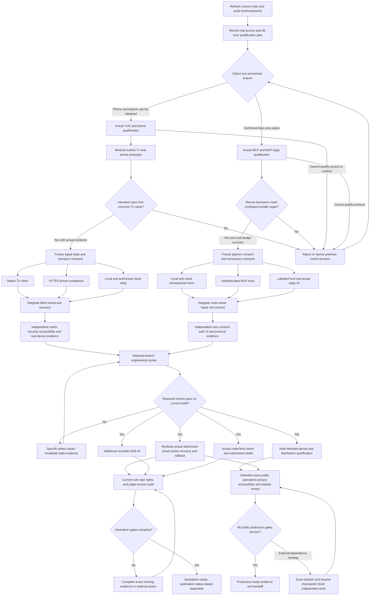

# Build and verification graph after the reassessment

This is an **unexecuted plan** for one selected project. [The 35-task JSON graph](REASSESSMENT_TASK_GRAPH.json) is the scheduling seed; [the team prompt](OPUS_SONNET_REASSESSMENT_BUILD_PROMPT.md) defines ownership, evidence and continuation. Native teams and checkpoints cannot manufacture external equipment or user validation.

Multiple incoming build/release lines represent an **AND join for the selected branch**. Only one branch is active. A failed evaluation is evidence of failure; it does not satisfy a release gate. The diagrams illustrate state/repair flow; the JSON dependencies govern executable task readiness.

| Stage | Tasks | Completion means |
|---|---|---|
| Rules, host, access and decision | C01–C04 | Current facts and one explicit conditional choice; missing access remains stated |
| Fire TV qualification | F01–F04 | Actual VVD/phone/listener and observed TV-specific value, with evidence limits |
| Fire TV construction and verification | F05–F13 | Complete native/phone/relay loop, independently reviewed metric/privacy/failure/accessibility evidence |
| Alexa qualification | A01–A02 | Actual MCP/Apps protocol and specific borrowing/rival evidence |
| Alexa construction and verification | A03–A09 | Real planner/consent/transaction/UI workflow and independent adversarial evidence |
| Engineering review | C05 | Selected branch passes current reproducible setup, minimum operating/rollback runbook and release criteria |
| Operations, OSS and submission | C06–C10 | Actual authorized service evidence, useful additional contribution, working demo and required fields/access |
| Public release | C11–C13 | Actual intended environments/users/distribution/operations verified; physical Fire TV required for its Appstore route |

The dependency graph itself is a DAG. Repair and resume are scheduler transitions, not circular task dependencies. A defect reopens affected work; a changed contract invalidates downstream evidence. External blockers do not justify skipping required tasks. Save exact next steps before interruption and respawn missing native teammates on resume.

Readiness is three separate values: engineering release candidate, hackathon-ready and public-production-ready. With VVD-only evidence, a Fire TV project may qualify for the hackathon while public distribution remains blocked. For Bee/Ring, first pass the real-data/official-stream gates in the category brief; create their dedicated task graph only if one becomes the selected project. Do not reuse Fire TV or Alexa evidence as proof for those tracks.

C07 is mandatory for this plan’s chosen additional Open Source scope, not for every primary-track entry. C06 verifies the actual deployment route; a local route does not imply cloud calls. C13 does not depend on the hackathon form/video gate. A scheduler must implement C05’s selected-branch join policy explicitly.
