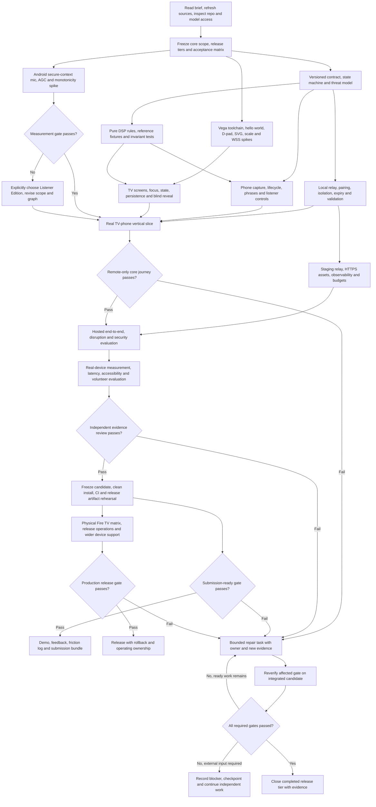

# Across the Room: evidence-gated agent-team execution graph

Prepared 5 October 2026 (IST). This is an orchestration design for the researched FTV-4 project, not evidence that an application has been built. Inputs read: `README.md` and `research/_working/spec_FTV-4.md`, including the 4 October core additions and fallback. Official Claude documentation was fetched through Firecrawl on 5 October; saved snapshots are listed at the end.

## 1. Verified model and runner setup

The requested models exist in current official documentation: Claude API IDs are `claude-opus-5-5` and `claude-sonnet-5-5`. Do not use guessed snapshot suffixes. Opus 5.5 is listed as released 22 September 2026; Sonnet 5.5 as released 28 September 2026. Account access must still be checked by the runner. [Opus overview](https://platform.claude.com/docs/en/models/opus-5-5/overview), [Sonnet overview](https://platform.claude.com/docs/en/models/sonnet-5-5/overview).

Claude Code requires at least v2.1.280 for Opus 5.5 and v2.1.284 for Sonnet 5.5. The local read-only check returned **Claude Code 2.1.284**. That is a CLI version check, not a successful authenticated model call. The `opus` and `sonnet` aliases resolve differently across providers; pin the full IDs when the provider uses Claude API IDs, resolve provider-specific deployment IDs when it does not, and record the actual selected models. Organization restrictions can cause a teammate to run on a substituted model. Detect and report this rather than silently asserting the requested team is running. [Model configuration](https://code.claude.com/docs/en/model-config), [teammate model selection](https://code.claude.com/docs/en/agent-teams#specify-teammates-and-models).

For a Claude API-backed interactive session, the documented launch shape is:

```sh
CLAUDE_CODE_EXPERIMENTAL_AGENT_TEAMS=1 \
CLAUDE_CODE_SUBAGENT_MODEL=claude-sonnet-5-5 \
claude --model claude-opus-5-5
```

Name Sonnet 5.5 explicitly in every teammate assignment. Before work, inspect `/model` and `/status`, relevant model restrictions and provider configuration. Do not print credentials. Treat an entitlement, provider or authentication error as an environment blocker; continue source inspection and other independent tasks.

Native agent teams are **experimental, interactive and disabled by default**. Setting the environment variable enables them. A `claude -p` or Agent SDK session does not create native teammates, even with that variable. Therefore do not promise a headless forever-loop running the same native team. An unattended runner is a different implementation, using independently supervised sessions or ordinary subagents, and must be named and tested as such. [Agent teams](https://code.claude.com/docs/en/agent-teams#enable-agent-teams).

Current native team constraints affect this project: one team per session; only the lead can manage teammates; the lead cannot be transferred; `/resume` and `/rewind` do not restore in-process teammates; task status can lag actual work; shutdown may wait for an active tool call. A session ending, the laptop sleeping, quota exhaustion, an unavailable service or a human stopping execution can stop work. Durability comes from a checked-in task manifest and evidence files, not a prompt promising infinite execution. [Limitations](https://code.claude.com/docs/en/agent-teams#limitations).

## 2. Team roster and write ownership

Opus 5.5 is the lead, architect and integrator. Sonnet 5.5 fills specialist roles. Start with three active implementation teammates, then rotate specialists as dependencies unlock. The role roster below describes responsibilities; it is not a requirement to run all roles concurrently. This limits file conflicts and token use while retaining independent review.

| Role | Model | Owns | Required handoff |
|---|---|---|---|
| Lead / integrator | Opus 5.5 | scope, architecture decisions, durable manifest, shared contracts, root configuration, integration branch, release decision | dependency graph; ADRs; reviewed integration; honest gate status |
| Vega / TV specialist | Sonnet 5.5 | `apps/tv/**`, `packages/ten-foot-meter/**`; holds simulator lease when assigned | install/build log, validated package, remote journeys, screenshots, tested focus and scale |
| Phone / signal specialist | Sonnet 5.5 | `apps/phone/**`, `packages/phone-mic-meter/**`, fixture generation and capture protocols | audio-lifecycle proof, DSP tests, device capability results, documented measurement limits |
| Relay / platform specialist | Sonnet 5.5 | `services/relay/**`, staging infrastructure and operations scripts | contract/security tests, deployed smoke results if credentials exist, rollback, cost controls |
| QA / reliability reviewer | Sonnet 5.5 | adversarial test cases and `docs/EVALUATION.md`; reviews other owners' commits | independently reproduced failures and pass results on the candidate commit |
| Security / privacy reviewer | Sonnet 5.5 | threat model, privacy checks, audit findings; initially read-only against implementation | room-isolation/replay tests, packet and log inspection, redaction, release-blocking findings |
| Accessibility / product reviewer | Sonnet 5.5 | ten-foot UX tests, copy and supported-user-flow review | D-pad/Back, focus, readable text, scale, non-colour indicators, tested screen-reader matrix |
| Release / documentation specialist | Sonnet 5.5 | setup, licenses, SBOM, operational guide, submission draft, demo scripts | fresh-install rehearsal, artifact inventory, claim-to-evidence and rules checklists |

Every task has one owner and one reviewer. The owner cannot approve their own acceptance evidence. The lead integrates only after a different teammate reviews the change. Review findings become tasks; they are not buried in chat. Only the lead edits the canonical task manifest, shared protocol schema and root lockfile. Module owners propose dependency or contract edits as patches or commits for the lead. This avoids simultaneous incompatible schema changes.

The lead must pass the product brief, allowed paths, base commit, contract version, definition of done and relevant evidence paths to each teammate. Teammates should challenge weak assumptions, report blockers promptly, and request cross-module changes through the lead instead of silently editing another owner's files. Teammates do not create nested native teams.

## 3. Isolation, integration and scarce-resource leases

Use a `codex/across-room-integration` branch by default in this workspace; adapt only to repository instructions. Create a separate worktree and task branch for each mutating specialist if Git state and permissions allow it. Preserve existing user changes. Do not reset, force-push or remove a worktree containing unsaved work. Record branch, worktree path, base commit and approved write scope in every task.

Native teams do not imply separate checkouts. In current Claude Code, passing `isolation` directly on the Agent call creates an ordinary subagent rather than a native teammate. For native teammates, the lead can precreate worktrees with normal Git operations and instruct each teammate to use the worktree's absolute paths for reads/writes and explicitly run shell commands from that worktree. First run a harmless path-identity check. If the runtime cannot reliably target separate worktrees, use strict folder ownership in one checkout and serialize root/configuration writes. State which strategy actually works. [Team creation rules](https://code.claude.com/docs/en/agent-teams#how-claude-starts-agent-teams).

Use a single integrator to cherry-pick or merge reviewed commits. Run relevant tests against the resulting integration commit, because separate branches passing does not prove the combination passes. For a conflict, pause only the affected paths, have the owner and reviewer explain the intended behavior, resolve once, and rerun impacted tests. Do not run concurrent npm installs against one checkout.

Maintain leases for the **Vega Virtual Device**, the real **Android test phone**, shared ports, staging deployment, fixture capture and final video recording. A lease records owner, purpose, acquired time and expiry. No other agent restarts the simulator, changes microphone settings, rewrites shared infrastructure or captures overlapping measurements during the lease. Expired leases require an owner check before reassignment.

## 4. Durable task and evidence records

Initialize the following in the actual application repository during implementation:

```text
docs/build/TASK_GRAPH.json
docs/build/STATUS.md
docs/build/DECISIONS.md
docs/build/BLOCKERS.md
docs/build/SESSION_HANDOFF.md
docs/build/RELEASE_CHECKLIST.md
docs/evidence/<task-id>/<attempt-id>/
scripts/validate-task-graph.*
scripts/verify-gates.*
```

These are project files maintained by the team, not invented Claude Code configuration. Do not pre-author or edit the runtime team-state directory under `~/.claude/teams/`; Claude Code owns it. Claude's native task list has pending/in-progress/completed states, and can be absent in environments without Task tools. Mirror the richer manifest into native tasks when supported, and use messages otherwise. The manifest remains authoritative for release evidence. [Task states](https://code.claude.com/docs/en/agent-teams#assign-and-claim-tasks), [architecture](https://code.claude.com/docs/en/agent-teams#architecture).

Recommended durable task states:

```text
planned -> ready -> running -> review_pending -> integrated -> verified -> done
                  |             |                |            |
                  +-------------+----------------+------------+-> needs_fix -> ready
                  |
                  +-> blocked_external -> ready after the missing input exists
                  +-> failed -> replanned successor task or explicit scope decision
```

`done` means acceptance evidence exists for the integration/release commit and the reviewer accepted it. An owner's “implemented” or native TaskCompleted event must not directly become `done`. `cancelled` is allowed only for an explicitly documented scope change. A cancelled required task blocks its gate until a reviewed replacement exists. `blocked_external` never counts as a passed gate.

Example durable task entry (illustrative, no result claimed):

```json
{
  "id": "T07-PHONE-LIFECYCLE",
  "title": "Capture levels locally and release the mic when a session ends",
  "status": "planned",
  "owner": "phone-signal",
  "reviewer": "security-privacy",
  "depends_on": ["T02-CONTRACT", "T04-MIC-SPIKE"],
  "gate": "G2-PHONE",
  "allowed_paths": ["apps/phone", "packages/phone-mic-meter"],
  "worktree": null,
  "base_commit": null,
  "candidate_commit": null,
  "acceptance": [
    "Permission refusal produces recoverable UI without a fabricated level",
    "No raw audio, encoded audio or PCM is transmitted or persisted",
    "End session, page hide, disconnect and explicit stop halt capture safely",
    "UI mic badge agrees with observed MediaStreamTrack lifecycle"
  ],
  "attempts": 0,
  "max_attempts": 3,
  "evidence": [],
  "review": null,
  "blocker": null,
  "next_action": "Implement only after the contract and real-device spike are reviewed"
}
```

Every evidence item includes task ID, exact command or human protocol, timestamp/timezone, commit SHA or artifact hash, runtime/device/browser versions, exit status, result, evidence path, reviewer and provenance. Provenance is one of `automated-real`, `device-observed`, `human-observed`, `recorded-numeric-fixture`, `synthetic-fixture`, `simulation` or `unverified`. Expected thresholds belong in the protocol before execution. A test log from an earlier commit cannot prove a later release; carry evidence forward only with a written impact assessment and rerun affected checks.

## 5. Dependency graph and repair loop

The initial graph is a DAG. Failures create new, bounded repair tasks; repair work returns to the affected verification gate. Do not turn the dependency DAG itself into a cycle. The diagram's arrows from a failed gate describe the scheduler's repair loop.



The full manifest should separate these nodes into 1–4 hour tasks rather than one enormous instruction per agent. Estimate hours as planning aids only. Every ready task must have resolved dependencies, an owner, approved paths and testable acceptance criteria. Include all specification AC identifiers and the Section 13 core features in the requirements matrix.

Suggested verification gates:

| Gate | Required evidence | What blocks it |
|---|---|---|
| G0 — scope/environment | current rules and compatible official platform docs; source-to-requirement matrix; model/CLI check; reproducible runtime inventory | unsupported SDK mix, missing model access, unreviewed scope ambiguity |
| G1 — Vega runtime | hello world and real compiled app on VVD; working remote keys; validated manifest; actual network path; tested scaling and rendering | browser-only mock pretending to be a Vega app; guessed CLI commands; missing simulator |
| G2 — phone/privacy | real Android Chrome HTTPS microphone capture; capability readback plus empirical monotonicity; track/Wake Lock lifecycle; packet/storage inspection | a Mac microphone presented as Android evidence; ignored AGC; audio sent or saved; misleading mic badge |
| G3 — contract/relay | schema and role constraints; token/room isolation; expiry checked by code; pairing races; duplicate/out-of-order/replay/malformed messages; redacted logs; transport compatibility | room takeover; audio/unknown keys forwarded; TTL treated as immediate deletion; silent fixture fallback |
| G4 — vertical slice | remote-controlled calibration → ahh → phrases → summary; blind-check and listener states; no scoring after cancellation/disconnect; restart and persistence | touch/keyboard needed after documented setup; missing core additions; late result corrupts score; session loop incomplete |
| G5 — measured quality | predefined DSP/noise/latency protocols; real vs fixture results separated; supported-device matrix; complete D-pad, contrast, scaling and screen-reader results; independent review | synthetic passes presented as device validity; thresholds changed to fit results without decision record; untested accessibility claimed |
| G6 — hackathon/submission | current official rules checked; reproducible VVD artifact and judge route; license and repository-access checklist; English video under limit; truthful feedback/friction log; no unresolved release blockers | absent live track demo, invented dates/results, judge access unverified, incomplete feedback |
| G7 — consumer production | supported physical Fire TV + phone/browser combinations; signed release and distribution requirements; production threat review; monitoring, budget, rollback, restore/deletion rehearsal; operations ownership | simulator-only evidence, store approval absent when needed, broad untested browser/device claims, unsupported measurement promises |

## 6. Continuous execution algorithm

“Keep going until complete” means keep claiming and finishing authorized ready work, integrate it, test it, and repair failures until the chosen release tier passes. It does not mean infinite retries, bypassing a failed measurement gate, or treating a human-only task as automated evidence.

```text
On start or resume:
  Read TASK_GRAPH, STATUS, BLOCKERS, decisions and last handoff.
  Inspect repository changes, worktrees, processes, leases and actual model IDs.
  Reconcile native tasks with durable states using artifacts, never chat claims alone.
  Respawn missing native teammates; do not message stale teammate IDs indefinitely.
  Validate graph is acyclic and every requirement maps to a task and a gate.

While authorized required work remains:
  Integrate reviewed commits one at a time; run affected verification.
  Accept evidence only when its commit/provenance satisfies the task.
  Dispatch independent ready tasks to the relevant Sonnet specialists.
  Require the next acceptance criterion and a concrete output in each assignment.
  If a gate fails, create a repair task containing the failing reproduction.
  After 3 attempts at the same failure, require lead diagnosis and a revised plan.
  Do not repeat the same command against the same unchanged environment.
  If all current work depends on a missing external input, checkpoint and report it.
  If quota/host/service stops the session, save an exact resume instruction.
  Never count blocked, cancelled or skipped required tests as passed.

When all gates for a tier pass on the frozen candidate:
  Run the fresh-install/release rehearsal once.
  Produce release artifacts, verified instructions, known limits and operational handoff.
  Stop at achieved completion, user cancellation, exhausted authorized budget,
    or a documented external blocker; do not invent more work to keep looping.
```

Three attempts is a default task policy, not a Claude platform guarantee. Retry only transient operations automatically, with bounded exponential backoff and jitter. For app reconnects use the reviewed specification policy; do not confuse reconnect retries with an agent repeatedly retrying a broken environment. A renewed attempt requires changed code, changed input, a verified workaround or a revised hypothesis.

After each integrated milestone and before compaction, write a concise handoff containing integration SHA, unfinished tasks, current blockers, exact next commands, active processes/ports, leases, latest failing test and artifact paths. Never store credentials in handoff files. At a true external blocker, continue docs, local implementations, fixtures, review and other independent work; report the smallest human action needed only when it is required.

Optional `TaskCompleted`, `TeammateIdle` and `Stop` **command hooks** can verify task evidence and prevent premature completion. Verify hook behavior against the installed Claude Code version and the current hook schema, then test one passing and one failing case. A completion hook should check the exact task gate and candidate SHA rather than rerun every expensive test on every turn. [Quality hooks](https://code.claude.com/docs/en/agent-teams#enforce-quality-gates-with-hooks), [hooks reference](https://code.claude.com/docs/en/hooks).

Hooks must allow idle when a teammate has no assigned ready work and allow a stop for a recorded external blocker, user stop, resource limit or achieved completion. Read the `stop_hook_active` flag before requesting continued work and bound repeated stop denials. Do not install a hook that always rejects stopping: that creates an expensive loop and cannot provide hardware, credentials or permanent process uptime. Hook scripts must fail explicitly when evidence is absent; a missing log is not a pass. This is a proposed project guardrail, not a promise that hooks will keep a session alive across shutdown.

## 7. Testing and evidence matrix

Use tests that verify meaningful behavior and boundary conditions, not tests that merely restate the implementation. Report each lane separately:

| Lane | Required checks |
|---|---|
| Pure signal/rule unit tests | RMS/dBFS numerical reference; silence/zero/NaN/clipping; floor variability; threshold boundaries; onset/offset/hangover; cancellation; dropped samples; percentile definition; time discontinuities; no evidence → no score |
| State and storage | every core state transition; retry/skip/finish; blind meter stays hidden until the intended reveal; early/late/duplicate listener verdicts; 3-cue cap; one session saved once; migration; corrupt storage; deletion/reset confirmation; restart/resume |
| Relay contract/security | roles and allowed messages; strict schema/size/rate bounds; code generation/collision and pairing race; authenticated room membership; token expiry; message/window/session identity; stale connection cleanup; replay and duplicate protection; cross-room leakage; no body/audio/token logs |
| Browser integration | permission refusal/revocation; secure context; unsupported AGC; phone background/lock/low-power; Wake Lock reacquisition; reconnect; track.stop on all required exits; long-poll fallback only if actually implemented; reconnect never silently reuses an invalid scoring window |
| TV runtime/accessibility | true VVD build/install; every screen by D-pad/OK/Back; no unreachable focus or focus traps; text wraps under scale; remote spam; Back safely cancels; screen-reader result recorded per environment; arc remains understandable without colour |
| End-to-end/failure | real TV + real phone + selected relay; package reinstall; relay outage; reordered/delayed messages; phone loss mid-window; app restart; expiry; offline/local judge route; labeled fixture route; degraded transport shown honestly |
| Real measurement | the spec's AGC test on actual phone(s); distance/placement held fixed; camera-based latency ground truth; predeclared noise/VAD protocols; numeric fixture provenance; actual listener disagreement reported; volunteer form-factor test treated as small exploratory feedback |
| Operations/release | lockfile install from a clean clone; exact build scripts; CI report; SBOM and applicable license notices; dependency vulnerabilities triaged; release package hashes; staging deployment/smoke; rollback; cost/quota controls; alert drills; data expiry/deletion |

Do not claim “all tests pass” when a hardware lane is skipped. A browser mock cannot prove Android microphone behavior, and synthetic number streams cannot prove that the microphone measures speaker effort accurately. The spec's 0/20 false-reached target describes its chosen soft numeric fixtures; it is not an estimate of the real-world false-positive rate. Its two-volunteer protocol cannot establish medical benefit, clinical efficacy or population-level impact.

Additional contract issues the implementation must resolve in an ADR before freezing schema:

- The example `sample` envelope carries `win` but not `session_id`, whereas the draft validation says results must match the current session. Add a consistent session/window identity and sequence policy across every scoring message; do not trust timestamps alone.
- The draft's “timestamp within 10 seconds of TV clock” can reject valid phone clocks. Use clock calibration plus monotonic elapsed time for duration and a reviewed skew/freshness rule for security; test wall-clock changes.
- Reject unexpected fields and forbidden binary/audio encodings by schema at clients and relay. “We send numbers only” must be proven from actual network/storage behavior, not only from a UI sentence.
- Numeric RMS detects energy, not who spoke, what was said or intelligibility. Two simultaneous speakers and prolonged fan/music may exceed the threshold. Record this limit and refuse ambiguous windows when detection evidence permits; no LLM or speech recognition is added to fabricate certainty.
- Monotonicity passing on one phone does not by itself validate cross-session loudness comparability. Default to same-session relative feedback. Cross-session dB comparisons require a separately accepted repeatability protocol with the same device, geometry and conditions; time/count history remains available.
- A response to `end_session` is not enough: local phone safeguards must stop capture if the end message is lost, the relay disconnects or the page is hidden. The badge must describe observed track state, and latency must distinguish estimates from camera ground truth.
- The draft's local `http://localhost` works on the Mac itself, not an unrelated phone on a LAN URL. A real-phone judge path needs valid HTTPS or an explicitly tested secure-context route. Self-signed TLS on VVD is unverified until observed.

These are proposed engineering resolutions based on the written contract, not new observed bugs in a built application.

## 8. CI and release policy

CI should run graph/schema validation, deterministic unit/contract/state tests, type checks, lint, phone build, relay/SAM validation and license/security checks on every relevant change. Verify exact Vega build environment before declaring a CI Vega lane; if a hosted runner cannot install or run the SDK, use a documented trusted macOS/self-hosted lane or preserve Vega verification as a separately evidenced local release check. Do not make CI green by substituting a web build for the Vega package.

Pin dependency versions and commit the correct lockfiles after the toolchain spike. Treat the Vega local Node version and Lambda runtime as separate compatibility decisions; the original spec uses Node 20 for Vega and Node 22 for Lambda, both requiring fresh official verification. Use temporary credentials/OIDC for deployment where supported, scoped least-privilege permissions, separate staging/production configuration, secret redaction and short log retention. Cloud services and billing must not be created until the real execution has the required credentials, authorized account and spending limits.

Require the frozen release commit's relevant CI lanes to pass, independent review approval and zero unresolved release-blocking findings. No disabled checks, fake success commands, overwritten failing logs or undocumented “temporary” exemptions. A preexisting unrelated low-severity dependency issue may be recorded with impact, containment, owner and deadline; it is not silently erased. Freeze scope after the core journey; optional why-line, starter phrases, caregiver export and Polly ship only if they clear the same gates within real capacity.

## 9. Finite completion tiers

| Tier | Definition of complete | Claim permitted |
|---|---|---|
| A — implementation ready | code, meaningful automated tests, architecture, reproducible setup, candidate artifacts and documented unrun hardware/cloud checks | “Implementation candidate; device/cloud gates pending” |
| B — hackathon ready | all Fire TV core features, real VVD-phone demo, evaluated supported phone, honest limitations, judge route and current submission requirements passed | “Hackathon-ready on the tested setup” |
| C — production release candidate | independently reviewed security, reliability, measurement and accessibility gates; physical supported-device matrix; deployment/distribution plan, operations and rollback passed | “Production release candidate for these tested platforms” |
| D — production released | authorized deployment/distribution completed, live smoke and rollback verified, account/store requirements satisfied and operating ownership accepted | “Released to the supported audience” |

The user's ambition is Tier D; continue all available work toward it. If only VVD is available, finish Tiers A/B and preserve the physical-device/distribution blockers for C/D. Never relabel simulator-only evidence as production-device approval. Production readiness is relative to a declared supported-device/browser matrix and documented user purpose, not a universal guarantee.

AI teammates are development agents, not additional human entrants. Do not add fabricated teammates or feedback participants to the hackathon submission. Two-volunteer testing, recording a genuine room measurement, obtaining release credentials, store-console actions and any required human certification need real authorized people. Generate instructions and artifacts first, then ask only for the genuinely missing action. The build must not mark these complete on behalf of a person who did not perform them.

## 10. Primary sources and saved evidence

| Source | Use | Saved snapshot |
|---|---|---|
| [Claude Opus 5.5 overview](https://platform.claude.com/docs/en/models/opus-5-5/overview) | model existence, exact Claude API ID, release date | Full content returned by Firecrawl search; model configuration also confirms ID/version |
| [Claude Sonnet 5.5 overview](https://platform.claude.com/docs/en/models/sonnet-5-5/overview) | model existence, exact Claude API ID, release date | Full content returned by Firecrawl search; model configuration also confirms ID/version |
| [Models overview](https://platform.claude.com/docs/en/models/overview) | model comparison and model API discovery | Full content returned by Firecrawl search |
| [Claude Code model configuration](https://code.claude.com/docs/en/model-config) | exact versions, alias/provider differences, restrictions, actual selected model | `.firecrawl/oct5/claude-model-config.md` |
| [Claude Code agent teams](https://code.claude.com/docs/en/agent-teams) | experimental flag, interactive-only runner, model precedence, runtime state, native states, limitations | `.firecrawl/oct5/claude-agent-teams.md` |
| [Claude Code hooks reference](https://code.claude.com/docs/en/hooks) | actual quality-hook events and exit-code behavior; bounded-stop guardrails | `.firecrawl/oct5/claude-hooks.md` |

The ownership, graph, retry limits, evidence schema and production tiers above are proposed engineering policy. They are not features automatically provided by Claude Code or guarantees from Amazon. Refresh official model/team docs at actual build start, and use the fresh hackathon/platform research in the main resource pack for Amazon-specific release and submission facts.
