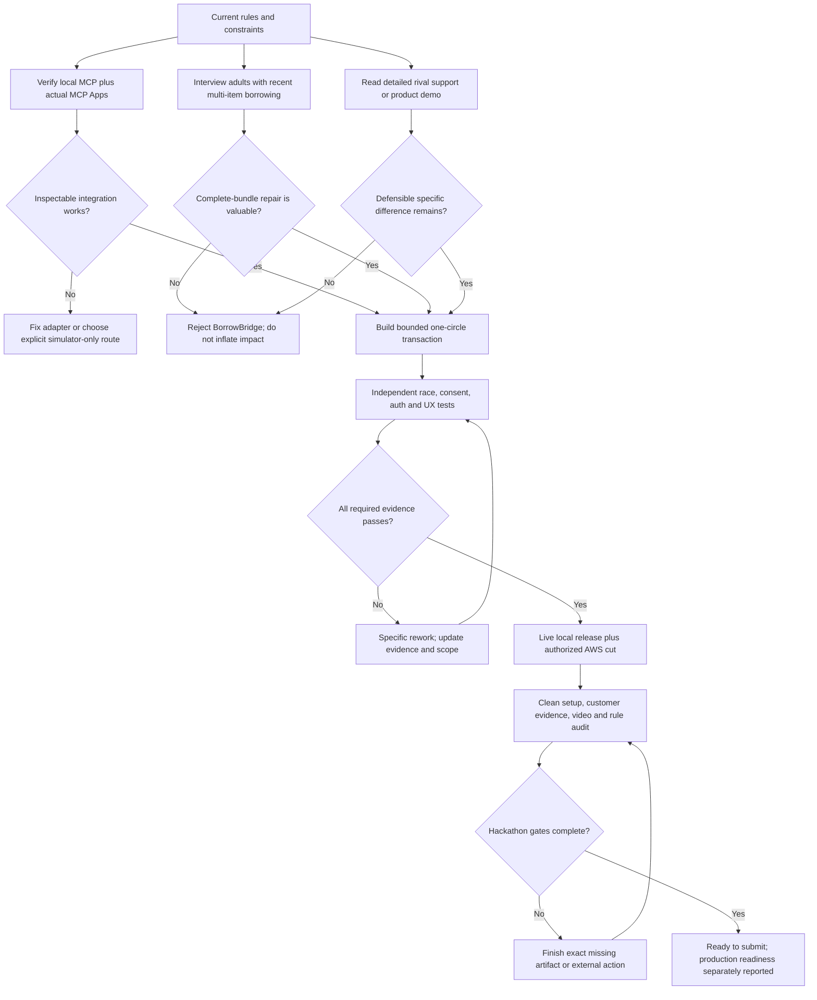

# Alexa+ track reassessment: BorrowBridge, with a hard novelty gate

**Researched:** 5 October 2026, Asia/Kolkata. **Scope:** solo India-based builder on the existing Mac; Echo, Android, Bee and physical Fire TV access unconfirmed. This is the Alexa+ contribution to the exhaustive four-track reassessment. **Status:** research and proposed specification only. No customer interviews, rival installs, product implementation or measured performance were completed. No win is guaranteed.

## Executive judgment

The earlier folder contains plausible proposals, not demonstrated winning projects. For Alexa+, I would not keep OutPass as the unconditional winner. Its verified residue is a child-initiated permission state machine with conditions; its ambient-device entry point, child attribution and notification delivery are simulated, and the customer need for a permission desk rather than a call or watch is untested. ClearPlate should remain rejected: the documented native allergy/preference memory and the previously identified Belay sharing product shrink its originality, while medical/allergy decision and child-supervision claims add risk without an accessible live Alexa integration.

**Best new Alexa+ candidate under these constraints: BorrowBridge — “Ask for the whole setup. Reserve it only when everybody agrees.”** It coordinates borrowing a low-risk event bundle from a private adult circle. One request becomes a bounded plan across multiple owners, resolves a conflict by changing a time or an acceptable item, gathers authenticated owner consent, then commits all reservations together or none. A real MCP server, real MCP Apps interface, real durable consent and concurrency checks run behind a clearly labelled independently built Alexa-style simulator.

This is a **conditional recommendation**, not a verified market gap. Lending itself, item bundles, reminders and reservations are already shipped. Lend Engine explicitly lets users reserve one or more items in a calendar and use a cart. The proposed wedge is cross-owner negotiation, immutable revision-bound consent, and preventing a “partial kit” after a race or decline. Those exact features were **not verified** in the reviewed myTurn/Lend Engine pages; that is not proof competitors lack them. If lending organizations or adult borrowing circles do not value the wedge, do not build a polished generic borrowing catalog and call it novel.

## 1. What the current official evidence allows

1. The current Official Rules permit a self-hosted MCP server implementing at least spec 2025-11-25 over Streamable HTTP, and also permit an independently built simulated Alexa+ experience; the simulation exemption does not require a specific MCP-shaped surface. We should nevertheless implement genuine MCP because its lifecycle, tool contracts and Apps UI can become inspectable technical evidence. [Official Rules](https://amazonappdev2026.devpost.com/rules), fresh shared save: `.firecrawl/reassessment-oct5/event-rules.md`.
2. Stage Two uses four equally weighted criteria: Tech Implementation, Design, Potential Impact and Quality of the Idea. The old folder’s five-factor weighted feasibility model is an internal planning model, not Amazon’s rubric. The Alexa+ examples distinguish a basic API wrapper from stateful agentic workflows, rich media, MCP Apps and Agent Skills. [Official Rules](https://amazonappdev2026.devpost.com/rules).
3. Amazon publicly states that Category SDK and MCP Toolkit are available to select partners. Toolkit geography is the United States. A solo entrant in India must not present public docs as proof of partner access. [Alexa+ documentation home](https://developer.amazon.com/docs/alexaplus/add-ons/home.html), [MCP Toolkit overview](https://developer.amazon.com/docs/alexaplus/add-ons/mcp-toolkit-overview.html).
4. Amazon’s overview explicitly documents MCP 2025-11-25 support and MCP Apps. Its lifecycle sample still uses 2025-03-26. Target 2025-11-25 and test compatible negotiation if the selected SDK supports it; do not infer the actual gated client’s behavior from a sample or introduce an unconfirmed later protocol as the sole build target. [Toolkit overview](https://developer.amazon.com/docs/alexaplus/add-ons/mcp-toolkit-overview.html), [client lifecycle](https://developer.amazon.com/docs/alexaplus/add-ons/mcp-toolkit-client-lifecycle.html).
5. MCP Apps is an interactive sandboxed UI extension: tool descriptions refer to a ui:// resource; the host fetches/render it and forwards UI tool calls. A custom browser component displaying a JSON result is not by itself proof that the MCP Apps protocol was implemented. [MCP Apps overview](https://modelcontextprotocol.io/extensions/apps/overview).
6. Amazon’s certification requirements emphasize stable identifiers, end-to-end transactions, cross-device continuity, explicit confirmation for consequential actions and duplicate prevention. Use these as design/test criteria without claiming certification. [Functional requirements](https://developer.amazon.com/docs/alexaplus/add-ons/functional-requirements.html).
7. Amazon already markets personal/document memory, calendar/email management, grocery ordering, restaurant reservations, voice-created routines and dietary-preference-based cooking support. “Alexa remembers X,” “turn a document into a calendar,” “plan dinner,” or “wrap one API” must earn their originality through a more specific mechanism. Marketing establishes advertised capability, not its quality in practice. [Alexa+ top features](https://www.aboutamazon.com/news/devices/new-alexa-top-features).

The broader report must retain the shared rule review for eligibility, deadline, code/license, video, judging access, track/mini-prize restrictions and friction-log evidence. This note does not replace that review.

## 2. Reassessment of the older Alexa concepts

| Older concept | Judgment | Why |
|---|---|---|
| ALX-5 OutPass | Plausible engineering demo; not a proven winner; demote | Requires a child/parent/host-family network and adoption argument that has not been tested. Actual voice attribution, Alexa notifications and Kids behavior are not publicly accessible in this build. The old rival audit already found Apple Watch/iPhone Check In, kid home phones and two visible family check-in/errand MCP projects. Its conditions and atomic ladder cancellation need to be shown as the residue, not check-in/approval as new. |
| ALX-4 ClearPlate | Keep rejected | Native Alexa preference/allergy recall and Belay caregiver-sharing collide. A deterministic refusal does not establish safe allergy advice or clinical value. Remove medical/emergency decision claims rather than dressing them with disclaimers. |
| ALX-3 ClaimTrail | Keep rejected as currently framed | The prior Brelly product/help reads found claim expenses, polished expense reports, estimate comparisons and reviewed external actions. Another evidence ledger is insufficient. Read actual help/product pages, not just homepages, before reopening it. |
| ALX-2 RideBook Access | Do not reopen without access and user evidence | Public real-service booking access was an earlier blocker. A simulated ride or accessibility promise cannot substitute for provider support. Routine ride booking is already an advertised Alexa category. |
| ALX-1 CarpoolMend | Not selected | Repairing a plan through consent can be useful, but driver/location/child-transport assumptions and calendar coordination create substantial validation work. The new candidate keeps the reversible coordination mechanism in a lower-stakes adult borrowing workflow. |

The old-concept facts above are synthesis of the local `IDEA_SCORECARD.md`, `RECOMMENDATION.md`, `spec_ALX-5.md`, `rivals_home.md` and `TRENDS_AND_RIVALS.md`. Existing rival citations: [Apple iPhone Check In](https://support.apple.com/guide/iphone/use-check-in-iphc143bb7e9/ios), [Apple Watch Check In](https://support.apple.com/guide/watch/use-check-in-apd7f329202c/watchos), [Ring Ring Club](https://ringringclub.com/), [daybreak](https://github.com/danielhagever/daybreak), [otsukai-mcp](https://github.com/shoujiki-panman/otsukai-mcp), [Brelly product](https://brelly.com/product/), [Belay](https://apps.apple.com/ca/app/belay-manage-food-allergies/id1303851165). **These were read in the previous research, not freshly re-scraped in this reassessment.** Current competitor changes remain possible. Repo READMEs are self-description, not independent proof of operating product quality.

## 3. Three new candidates and the choice

| Candidate | Specific proposed mechanism | Why it could fit | Main reason to reject |
|---|---|---|---|
| **BorrowBridge** | A private adult circle lends a complete event bundle across multiple owners; proposed time/item changes need revision-bound consent; one-store commit reserves all resources or none | Visible transactional wow; low hardware dependence; actual MCP Apps; state across sessions; deterministic constraint and concurrency tests | Catalogs, carts, multi-item reservation and reminders are already common. Cross-owner consent/repair demand is unverified. Alexa adds a conversational entry point but is not uniquely necessary. |
| **CoverShift** | For noncritical adult community event duties, an absent volunteer proposes a swap; outgoing/incoming volunteers and organizer explicitly accept; a failed acceptance leaves the original assignment intact | Clear plan-repair story and auditable state | Lotsa already supports cancellation/reassignment and group coordination. SignUpGenius and roster products are direct rivals; another task/calendar assistant has weak originality without a genuinely better repair mechanism. |
| **RoomReset** | Shared adult event-space reservation changes room, equipment and cleanup assignment as one approved local plan; explains which constraint caused a rejection | Bounded scheduling and tangible user interface | Existing booking/approval products are likely strong; institutional access and rules are harder to obtain and validate solo. One-store reservation guarantees would not apply to external facility systems. |

Freshly searched primary evidence for the alternatives includes [Lotsa Helping Hands](https://lotsahelpinghands.com/), [coordinator introduction](https://www.lotsahelpinghands.com/help/pe_intro_coordinators.html) and [How it works](https://caregiver.lotsahelpinghands.com/how/). Search excerpts show task cancellation/reassignment; they are not a full current feature audit.

**Selection: BorrowBridge, if the two-day customer/competitor gate passes.** It makes the most inspectable lower-risk technical artifact with unconfirmed hardware. Do not portray it as globally original or claim the other tracks cannot beat it. The comparison is an engineering/product judgment under the stated constraints, not a calibrated prediction of judge scores.

## 4. BorrowBridge product specification

### Customer and problem

Adults in one trusted community—friends, apartment neighbors or a club—share low-risk event items: a board game, a folding-chair set, a cooler or a small speaker. An organizer needs a complete setup for a specific time. Separate “yes” messages can arrive for different times, owners can change their mind, and a late conflict can leave only part of the setup available. That exact coordination problem is a **hypothesis**; existing lending products verify the category, not this pain or its frequency.

Suggested pitch:

> “You do not need a reminder that someone has a chair. You need a complete, agreed setup for Saturday. BorrowBridge finds a workable bundle, asks each owner, and reserves it only when every approval still applies.”

Avoid quantified money/carbon savings, “most households,” typical-frequency figures or satisfaction claims until measured. Do not prescribe safe use of an item or accept medical/childcare/security-critical resources.

### Core journey

1. Create or join one private adult circle and register owned items with bounded availability.
2. In the labelled Alexa-style host, say/type: “Can I borrow a cooler, four chairs and a speaker Saturday 5 to 7? An hour later is okay.”
3. The agent resolves catalog identities, asks one necessary clarification, then calls the deterministic planner. It never invents inventory or another person’s agreement.
4. Show an MCP App card: exact objects, owners, time zone, pickup/return windows and the specific blocked resource. A proposal might use 6–8 instead, or a permitted equivalent speaker.
5. The borrower accepts that exact proposal revision. Authenticated owner browsers show the same terms and independently approve/decline. Voice attribution is not an authorization mechanism.
6. Only after all approvals and a final borrower confirmation, the server conditionally commits every reservation in this store. If a version changed, approval expired or any resource is taken, return “Plan changed; nothing reserved,” preserve the original intent and propose a new revision.
7. Resume on another browser/session: show actual state and missing approvals, not a new plan.
8. Check items out and back in manually with explicit per-item receipts. A receipt is a person’s report, not verified physical possession or automatic location tracking.
9. Cancel with clear scope/confirmation; release future local reservations idempotently. Export a downloadable ICS receipt and delete local/private-circle records according to policy.

The borrower never obtains power to approve for an owner. “Approve all” is not a model tool.

### Distinctive live proof

- Two browser windows rush to reserve the same resource. Exactly one accepted bundle commits.
- One owner approves revision 2, then the requester changes the return time. Revision 2 approval cannot approve revision 3.
- One owner declines. No resources become finally reserved.
- A repeated final commit returns the same reservation receipt.
- A pending plan survives a new MCP initialize/session.
- Interrupted communication never changes unknown state into success.

## 5. Closest rivals and what remains uncertain

| Rival | Fresh primary evidence | Direct collision | Proposed residue and uncertainty |
|---|---|---|---|
| Lend Engine | [Loan-management features](https://www.lend-engine.com/features/loan-management-software) | Self-serve/member/staff lending; cart; reservations for one or more items; opening-hour-aware availability; reminders; configurable checkout prompts; deposits; extensions | Independent owner negotiation and immutable approval per proposal revision were not verified in the page. A cart or multi-item booking is therefore not new. API docs and a real demo must be checked before claiming a gap. |
| myTurn | [Lending-library software](https://myturn.com/lending-libraries/) | Inventory lending/tracking, reservations, reminders, analytics, import/export, integrations | Cross-owner transactional plan repair was not verified. Professional/custom integrations could implement it. No product was installed. |
| Native Alexa+ | [Current top features](https://www.aboutamazon.com/news/devices/new-alexa-top-features) | Memory, documents, calendar scheduling, shopping, routines and reminders | A private resource ledger with conflict arbitration and actual owner authorization is server behavior, not LLM memory. Consumer voice access remains simulated for this entrant. |
| Informal chat / spreadsheet | Common-workaround hypothesis, not independently surveyed | No onboarding, simple for small groups | May be preferable for three items. If an adult circle finds explicit proposal/approval overhead worse than chat, the idea fails despite passing tests. |

The queried Library of Things `/impact` path returned a not-found page. No impact numbers or environmental claims from that URL are used. A saved HTTP/scrape success is not proof of usable source content.

## 6. 45-second wow and complete video

### 45-second live beat

- **0–8 s:** One natural-language request becomes a three-item plan card.
- **8–15 s:** A conflict is explained using actual ledger data: the speaker is booked at 5; an allowed 6–8 slot works.
- **15–27 s:** The borrower approves the revised window; three authenticated owner views approve the exact same revision. Demo actors can be one tester controlling separate accounts, explicitly disclosed.
- **27–35 s:** Final confirmation commits the complete local bundle. The app shows a human-readable receipt and which owners approved.
- **35–45 s:** Repeat commit or attempt a stale-race commit. The server returns the existing receipt or “nothing reserved”; show the actual invariant/query result in a separate developer evidence panel.

Preloaded item records are labelled demo inventory. These are real tool calls and state changes over synthetic inventory, not prerecorded Alexa behavior.

### Under-three-minute video

- 0:00–0:20: Specific customer and thesis; visible simulated-host disclosure.
- 0:20–1:05: The complete happy path above.
- 1:05–1:35: Owner decline, changed revision or concurrency race; recover without losing original intent.
- 1:35–1:55: Fresh MCP session resumes; checkout/return and cancel.
- 1:55–2:20: Inspector negotiation/tool/resource calls, real MCP App sandbox communication and actual transaction/evaluation artifacts.
- 2:20–2:45: One customer validation result, nearest-rival distinction, privacy and limitation.
- 2:45–2:55: Repo, setup, open-source component and actual AWS architecture.

Do not put a large preamble before functionality. Do not compress a timed deadline into seconds without a conspicuous test-clock label.

## 7. Architecture and tool contracts

### Scope of atomicity

**Atomic means only mutations in one circle’s owned transactional store.** It does not include physically moving items, calendars, messages, SMS, third-party lending platforms or payments. Any external write requires a separate saga, delivery status and possible compensation. No true cross-service atomicity claim is allowed.

Core architecture:

```text
Independent Alexa-style host + actual MCP Apps sandbox
   └─ authenticated MCP client, 2025-11-25 Streamable HTTP
      └─ TypeScript MCP service
         ├─ bounded deterministic planner
         ├─ authorization + immutable proposal/approval rules
         ├─ local SQLite reference store
         └─ AWS DynamoDB transactional store
            └─ optional scheduled expiry/cleanup, redacted metrics

Bedrock/Strands agent: interpret and orchestrate read/plan tools.
Human browser actions: exact approvals and final commitment.
No LLM may invent availability or bypass a server authorization check.
```

Use SQLite transactions locally. On AWS, use DynamoDB conditional/transact writes with an explicitly bounded slot representation. Suggested bounds: max four item resources, half-hour-aligned windows up to two hours, one circle, a seven-day planning horizon. Chairs can be one predefined set/resource; arbitrary quantity inventory is out of core. Time zone and DST are server-parsed and displayed. Bound total transaction item count before selecting the store. These are proposed architecture choices to validate against current AWS docs, not proof of implementation.

Suggested MCP tools:

| Tool | Role/input | Result/invariant |
|---|---|---|
| `list_circle_items` | Authenticated member; filter/category | Actual visible item IDs, owners, aliases, revision |
| `plan_bundle` | Member; required item/category IDs, time window, allowed substitutions | Structured feasible candidates or explicit constraints; no writes/consent |
| `propose_bundle` | Borrower; selected candidate + expected revision | Immutable proposal ID/revision/hash/expiry; idempotent key |
| `get_proposal` | Relevant borrower/owner | Current status, missing decisions, expiry and human-readable terms |
| `decide_offer` | Authenticated owning member; proposal revision, accept/decline | One consent record bound to that revision; wrong owner rejected server-side |
| `commit_bundle` | Borrower; exact proposal revision + confirmation token | One all-or-none store transaction; duplicate receipt unchanged |
| `cancel_bundle` | Authorized borrower/owner; exact scope + confirmation | Idempotent release/cancel, pending actual return if checked out |
| `record_handoff` | Relevant authenticated party; item + pickup/return declaration | Timestamped self-report receipt; no inferred possession |
| `get_bundle` | Relevant members; stable ID | State survives fresh sessions |
| `export_or_delete` | Authorized account; explicit confirmation for delete | Minimal export / verified retention/deletion outcome |

Expose accurate input/output schemas, readOnly/destructive/idempotent annotations and `structuredContent`. App-only presentation metadata is not security; authorization checks apply regardless of which host sends a call. Serve the real UI resource and test its protocol. Never accept sender identity/owner role from editable tool arguments. Bind auth to the actual connection/account.

Threat/evaluation cases: item-description prompt injection; “approve as Dev”; leaked or expired invite; replay; cross-circle enumeration; stale consent; duplicate writes; malicious HTML-looking item text; overlapping slots; same item repeated twice in a bundle; timezone ambiguity; background/network interruption. Catalog text is untrusted data. Authenticate public hosting; a localhost shortcut must be described as local only.

### Honest live-versus-simulated matrix

| Component | Demo claim |
|---|---|
| MCP initialize/list/call/read over Streamable HTTP | Live and inspected |
| MCP Apps UI protocol, actual resource + sandbox | Live when verified; otherwise pending, never substitute ordinary React card evidence |
| Constraint planning, consent and one-store commit | Live, with synthetic catalog |
| Owner identities/decisions | Real authenticated test accounts + actual human clicks; demo role switching disclosed |
| Native Alexa+, Echo hardware, partner CLI/toolkit deployment | Simulated/unavailable |
| Alexa Voice ID and native scheduled Alexa notification | Not implemented or claimed |
| Browser text/voice capture | Browser implementation; voice optional and support limits disclosed |
| Item possession, real community adoption or savings | Human-reported/demo only until independently validated |
| AWS hosting/infrastructure | Live only if deployed/inspected; local reference works without it |
| External calendar integration | Downloaded ICS receipt in core; not an atomic calendar transaction |
| Production distribution/certification | Pending external requirements, not inferred from a working web demo |

## 8. Minimum, full and excluded scope

**Minimum finished cut, 50–65 h estimate:** one circle, four preloaded low-risk resources plus add/edit, three owner accounts, deterministic three-item planning, one type of time repair, authenticated approvals, atomic local commit, cancel/status/return, real 2025-11-25 MCP and MCP Apps, replay/concurrency/security tests, clean setup and video. Estimate includes integration/tests; it is unmeasured.

**Full hackathon cut, roughly 75–90 h estimate:** AWS transactional store and host, Bedrock/Strands language-to-plan agent with bounded structured inputs, one allowed item substitution, persistent resume, effective expiry/revocation, original low-risk inventory UI, optional authorized notification channel with actual delivery status, accessible screen/voice fallbacks, operations/rollback, two validation sessions and an open-source package. Reserve the final two days for submission and failures.

**Excluded:** open marketplace, strangers, payments/deposits, insurance, medical items, childcare, doors/access control, automatic possession/location, arbitrary external library synchronization, multi-circle swap cycles, safety instructions, guaranteed notification, partner certification. Adding an arbitrary service adapter to make an architecture diagram busier does not strengthen the customer experience.

AWS Builder entry should describe the real planner/agent/tool/transaction pipeline and actual deployed services. Open Source should contribute a reusable `mcp-consent-bundle` package or real improvement to an existing MCP Apps project, with tests/examples/license—subject to the current challenge rules, rather than a README-only component.

## 9. Measurable gates before “ready”

Targets below are proposed and must be frozen before measurement:

1. **Novelty/customer gate:** interview at least three adult borrowing-circle members or small library organizers. Ask them to complete a recent actual multi-item request with their current method, then test a paper/prototype proposal. Record time, number of messages, partial confirmations, comprehension and preference. Pass requires at least two independently expressing the complete-bundle/changed-term pain and preferring the consent/repair journey. Three convenience interviews are weak evidence and must be described honestly.
2. **Rival gate:** obtain a Lend Engine/myTurn demo or primary detailed support/API evidence. If the same cross-owner revision-bound bundle workflow is already present, narrow the wedge or reject the idea. Do not treat unread features as absent.
3. **MCP conformance:** Inspector negotiates 2025-11-25; list/call/read and fresh-session resume succeed; real UI resource renders and sends a UI tool call. Preserve transcript/commit.
4. **Transactional invariant:** 100 deterministic randomized concurrent local runs plus deployed-store integration cases produce no committed partial bundle, no double-booked time bucket and no consent applying to another revision. Tests use independent expected outcomes and fault injection, not merely mirrors of helper code.
5. **Authority:** model/borrower cannot approve for owner; cross-circle wrong-role and stale/expired credentials always rejected in the fixed threat set. Zero breaches in a test set is not general security proof.
6. **Language parsing:** 60 predeclared normal/ambiguous/adversarial requests; no invented inventory/owner approval; missing/ambiguous times prompt clarification. Evaluate a real runtime model if used, not only a deterministic fixture parser.
7. **Complete journey:** create → plan → repair → consent → commit → resume → checkout/return → cancel/delete; with decline, race, duplicate and connection-loss recovery.
8. **Accessibility/design:** keyboard and screen-reader use of all core surfaces, visible focus, text/shape plus color, time-zone clarity, one-phone owner flow, voice-only concise summaries without exposing developer IDs.
9. **Observed performance:** measure at least 30 hosted calls, report warm/cold p50/p95/max separately, and target p95 below 2 s for non-model read/commit calls if feasible. Do not report Bedrock round-trip as a server-only measurement.
10. **Operational evidence:** redacted logs, actual origin/auth controls, expiry without relying on asynchronous TTL for revocation, deletion verification, clean checkout setup, bounded budget/rate limits and tested rollback.
11. **Release:** public/judge-readable source as rules require, current rule validation, detected license, genuine friction log, unedited functional video, and no native Alexa deployment claim.

Readiness requires evidence per requirement, not a high idea score.

## 10. Fatal assumptions and a decision graph



- The transaction must fit the chosen store and bounded resource representation; an external reservation API cannot inherit its guarantees.
- The customer may prefer a group chat; if so the idea is technically elegant but product-weak.
- Private circle onboarding may cost more than the borrowing friction it replaces.
- A simulator can qualify while still lowering perceived Alexa-specific value. Counter this with inspected protocol behavior and device-appropriate concise/card interaction, not false hardware branding.
- “Agent team” improves implementation coverage but creates no new customer benefit by itself.
- Exact requested model identifiers or API entitlements must be verified; no model-name assertion from the old prompt proves account availability.
- Production readiness needs actual user/device/deployment evidence beyond the hackathon simulator. Mark it separately.

## Sources and collection record

Fresh Firecrawl searches saved: `alx-search-native.json`, `alx-search2.json`, `alx-search3.json`, `alx-search4.json`. Eight usable fresh primary full-page captures:

| Source | Saved | Quality / use |
|---|---|---|
| https://developer.amazon.com/docs/alexaplus/add-ons/home.html | `alx-gating.json` | Official access restrictions |
| https://developer.amazon.com/docs/alexaplus/add-ons/mcp-toolkit-overview.html | `alx-toolkit.json` | Official documented version, geography and Apps |
| https://developer.amazon.com/docs/alexaplus/add-ons/mcp-toolkit-client-lifecycle.html | `alx-lifecycle.json` | Official sample lifecycle; version conflict disclosed |
| https://developer.amazon.com/docs/alexaplus/add-ons/functional-requirements.html | `alx-functional.json` | Official transaction/continuity design criteria |
| https://www.aboutamazon.com/news/devices/new-alexa-top-features | `alx-native-features.json` | Vendor advertised features, no effectiveness measure |
| https://myturn.com/lending-libraries/ | `alx-myturn.json` | Competitor vendor feature description |
| https://www.lend-engine.com/features/loan-management-software | `alx-lendengine.json` | Detailed competitor feature page, strongest direct challenge |
| https://modelcontextprotocol.io/extensions/apps/overview | `alx-mcp-apps.json` | Primary Apps protocol explanation |

Shared official-rule/resource fresh captures are under the same `.firecrawl/reassessment-oct5/` folder. The requested Library of Things `/impact` retrieval first encountered shared-rate-limit/tool failure and then returned a not-found body; saved `alx-lot-impact.md` is excluded evidence. Earlier rival references are explicitly marked previous-session evidence. No absence claim or projected performance is treated as verified.

## Rerun inputs

workflow: firecrawl-deep-research
topic: Alexa+ strongest complete project under solo India, unconfirmed hardware constraints
depth: exhaustive across four tracks; this file is one track’s delegated research angle
output: cited markdown, raw Firecrawl captures, conditional build specification
novelty_test: cross-owner revision-bound bundle negotiation versus Lend Engine/myTurn and group chat
final_claim: promising conditional candidate, no guaranteed win

