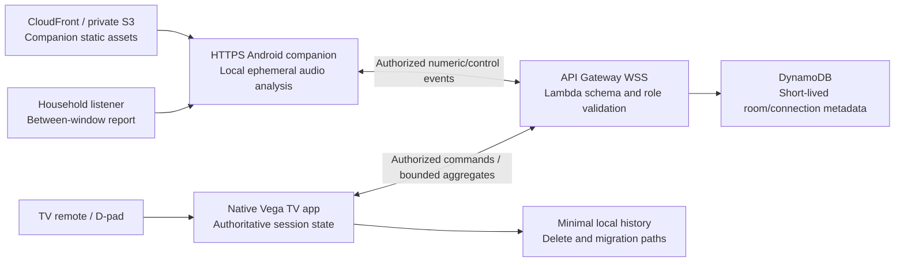

# Fire TV reassessment: the strongest project is a conditional Carryover Check

**Research date:** 5 October 2026, Asia/Kolkata. **Status:** research and product specification; no application, device trial, customer interview or efficacy study was performed. This is the Fire TV angle of the current exhaustive cross-track reassessment.

## Decision

Of the five existing Fire TV ideas and the new alternatives tested in this pass, retain **Across the Room**, but recast it as **Across the Room: the Carryover Check**. The important product is a remote-controlled household practice session that separates **how the speaker thought it felt**, **whether the listener reports hearing it**, and **the relative signal reaching a stationary microphone**. A loudness meter, vowel timer, personal phrase bank and seven-day chart by themselves are already served by other products or straightforward adaptations.

This is the strongest differentiated Fire TV hypothesis in this evidence set, **not a proven winning idea**. It becomes a credible contender only if actual phone/Vega evidence and intended-user evidence survive the gates below. Its two serious weaknesses remain unqualified distant-phone measurement and unproven customer preference for this particular TV workflow. If those fail, do not rationalize them away with a larger agent team or a “production” label.

The earlier folder recommendation is useful analysis, but it overstates confidence when it calls the live wow “un-stageable”, implies a lack of visible entrants establishes originality, or treats lower estimated build effort as a reliable fact. The scorecard itself correctly discloses that its three judge lenses are model estimates, that its weighting differs from the actual rubric, and that FTV-3 slightly leads FTV-4 after red-team scores. None of those decimals predicts a prize.

## Official-rubric correction

The fresh [Official Rules](https://amazonappdev2026.devpost.com/rules) have **four equally weighted** Stage Two criteria: technology implementation, design, potential impact and quality of the idea. Tie resolution follows the order of those criteria. Feasibility is a practical decision gate, not an additional official weighted criterion. Stage One separately checks theme and required-technology viability.

Fire TV requires a demo-ready app working on Fire OS or Vega OS, with the video showing an actual Fire TV or Fire TV/Vega simulator. A browser-only mock does not satisfy that rule. Multimodal interaction is a creative example; this project's mapping of acoustic input, D-pad control and native visual feedback to that example is an inference, not an organizer endorsement. The rules do not require a generative model. A superficial AI add-on should not displace a reliable core. [Official Rules](https://amazonappdev2026.devpost.com/rules).

The project is eligible **only after it actually runs on the required environment**. Current Vega docs demonstrate available focus, network, SVG, persistence and accessibility interfaces; they do not prove that this project has built. Actual physical Fire TV testing is an additional Appstore release requirement even though VVD is accepted for the hackathon. [Focus](https://developer.amazon.com/docs/vega/0.24/focus-management), [Run/test guide](https://developer.amazon.com/docs/vega/0.24/run-apps), [pre-submission tests](https://developer.amazon.com/docs/vega/0.24/test-before-submission).

## Audit of the existing Fire TV ideas

| Existing concept | What survives | Why it is not yet a strong winning claim | Disposition |
|---|---|---|---|
| FTV-1 Story Night | Shared-photo storytelling and attribution of contradictory memories are a plausible group experience | Remento, Storyworth and StoryCorps already serve capture; the TV/group benefit is untested; original estimate is 140 solo hours; transcription, consent, recording, archiving and media playback add scope | Keep as a future team project, not the current solo choice |
| FTV-2 WordGlow TV | Word-level remote interaction and deterministic generation constraints are coherent | Easy to perceive as the rules' obvious video-player category; evidence for same-language subtitling does not validate the new AI-story intervention; child-content review and adaptive content pipeline add risk | Do not choose without a compelling TV-specific child/parent test |
| FTV-3 Mail Check | Remote capture and source-region evidence are useful; excellent measurable OCR/geometry engineering | Apple's current Magnifier already captures documents, customizes/reflows text, reads aloud and answers a bill-total question; rival/entrant overlap remains high; low-vision TV preference and reliable capture untested | Strong technical runner-up, weaker differentiated thesis |
| FTV-4 Across the Room | Far listener geometry, remote operation and separate subjective listener feedback are a defensible product hypothesis | Free phone biofeedback/functional practice already exists; level is not intelligibility; actual distant-phone behavior and demand missing; expanded estimate leaves almost no slack | Retain only with redesigned core and falsification gates |
| FTV-5 Measure by Measure | Native remote loops plus phone-note synchronization can demonstrate technical work | Score Wizard now explicitly advertises hands-free score following and automatic page turning for arbitrary PDF scores, Mac/iPad, pedal/gesture/eye-blink control; Yousician/Simply Piano add listening instruction; prior originality confidence was too high | Drop from the top rank |

The table combines fresh sources below with the existing local scorecard/specifications. It does not claim every rival was installed. Vendor pages establish advertised overlap; they do not establish comparative quality, clinical benefit or complete feature absence.

### Named-rival findings that change the decision

1. **Loud and Clear is a serious direct rival.** Its current [App Store listing](https://apps.apple.com/us/app/loud-and-clear/id1491171131) describes phone/tablet microphone biofeedback, volume and pitch warm-ups, then functional everyday speech practice. It is free. Its developer replies to a user review saying manual progression will be incorporated; a review is not a confirmed current capability, but it means user-paced progression is not a durable moat. The [voice-fitness page](https://loudandclear.io/parkinsons-voice-fitness/) contains older warm-up examples; its webinar schedule is undated historical content and is not evidence of a current 2026 schedule.
2. **Speak Up already has phrases and free-form practice.** Its [App Store listing](https://apps.apple.com/us/app/speak-up-for-parkinsons/id784117908) describes words/phrases, reading/conversation, volume meter and audio/video feedback. Reviews complain about target volume, phrase repetition and microphone permissions, but these are individual, possibly old anecdotes, not a verified current failure rate. Household phrases, actual permission-state recovery and user-paced operation can answer such friction; they are execution advantages rather than a new market.
3. **Voicibel already implements a target-range meter.** Its [listing](https://apps.apple.com/us/app/voicibel/id6444749376) advertises setting a range and speaking into it. The developer declares no data collection; Apple explicitly says privacy declarations are not independently verified. “No audio upload” alone cannot justify originality.
4. **Mail Check's main AI/OCR task is available natively elsewhere.** Apple's [current official Magnifier guide](https://support.apple.com/guide/iphone/magnify-information-iphe867dc99c/ios) describes Ask Magnifier with a bill-total example, document/multi-photo capture, Reader formatting and read-aloud. Feature availability depends on supported hardware, OS, language and region. The precise TV remote/source-crop workflow can still differ, but “read a bill for someone with low vision” is not the novel thesis.
5. **Measure by Measure faces a stronger score-following rival than the previous pass established.** [Score Wizard](https://apps.apple.com/no/app/score-wizard/id1438151717) now describes real-time automatic page turning and a cursor following arbitrary PDF scores, with Mac/iPad, pedals, gestures and eye-blinks. The search result carried a misleading “iOSTV” fragment; the inspected listing identifies **iPad and Mac**, not Apple TV. Do not repeat the search fragment as platform proof.
6. **A new shared-caption TV idea also collides.** [Ava](https://www.ava.me/) advertises real-time conversation captions, speaker attribution, transcripts and summaries. [Live Caption](https://apps.apple.com/us/app/live-caption/id955278049) appeared in search with an explicit Apple TV larger-display description; only its snippet was read in this pass. That is a named overlap warning, not a full product audit. A “family captions on TV” pivot therefore needs a more substantial mechanism than casting captions.

## Three strengthened/new candidates

| Candidate | Core mechanism | Judge-visible proof | Main failure condition | Decision |
|---|---|---|---|---|
| **Across the Room: Carryover Check** | Separate speaker perception, listener report and qualified per-session level; hide the meter during selected trials; TV remote controls timing and reveal | One unedited live session showing a genuine disagreement and no false success after noisy input/disconnect | Intended users do not prefer/need it; phone behavior cannot qualify; result wording implies comprehension | **Best current Fire TV hypothesis** |
| **Mail Check: Evidence Desk** | Remote shutter, large source image, four extracted fields, geometry-backed “show me”, explicit uncertainty and user confirmation; no freeform model conclusions | Deliberately ambiguous date returns uncertainty; remote zooms the exact crop and the user confirms | Current native/rival reader is as good; capture quality/accuracy fails; no intended-user benefit | Reserve alternative if phone measurement fails early and OCR path proves itself |
| **Caption Circle: Shared Turn Board** | Each participant's nearby phone supplies a separately attributed caption stream; remote pins/corrects/replays text and mediates turns; no automatic speaker identity | Overlapping inputs remain attributed, late corrections update the right text and a hard-of-hearing user controls pace | Ava/phone mirroring provides equivalent value; multiple microphones/consent become cumbersome; cloud ASR latency dominates | Novel candidate tested by rival search; **do not select** under current solo constraints |

“Carryover” here names transfer from screen-directed practice to a household phrase without visible meter feedback. It does not claim a clinical outcome. No reviewed vendor source established the exact three-part TV/far-microphone/listener workflow. That is a bounded research result, **not evidence that nobody has built it**.

## Detailed selected-project specification

### One-sentence pitch

**Across the Room lets a household practise the phrases they actually say from one side of the living room to the other, using the TV remote, and shows speaker perception, listener response and relative sound as three separate pieces of feedback.**

### Initial user and concrete job

An adult with an existing clinician-provided home practice plan and a consenting household listener can practise their own short phrases without holding or watching the microphone phone. The TV provides large prompts, predictable pacing and shared results. A household without a clinician plan may demonstrate ordinary communication practice; the app must not generate a treatment schedule or advise maximal effort.

The primary testable job is **making a shared practice routine usable and informative**, not diagnosing dysarthria, treating Parkinson's, measuring calibrated SPL, detecting the intended speaker, or establishing speech comprehension. Regulatory classification is not settled by a disclaimer; public deployment requires the appropriate intended-use/privacy/distribution review.

### Core product: keep six capabilities

1. **Native TV setup and remote focus.** Large instructions, code/QR pairing, start/pause/retry/skip/finish, predictable Back, visible focus and screen-reader support. Prove this on VVD.
2. **One stationary phone.** Secure HTTPS page, explicit microphone consent, track settings, capture lifecycle and a marked position beside the TV. Listener controls unlock between capture windows, so microphone handling does not contaminate those windows. The speaker never needs to touch the phone after setup.
3. **A short quality/precheck stage.** Quiet-window aggregate, per-session calibration when the qualified phone mode supports it, and clear invalid/noisy/clipped/interrupted states. Never convert noise into success.
4. **User-paced household phrases.** One to ten original phrases, literal rendering, capped lengths, remote-controlled start/stop and no forced timed advancement.
5. **Three blind/reveal trials.** At applicable phrase positions 3/6/9, hide all meter output and accessible result leaks. Speaker rates Felt loud/Felt normal/Skip. Listener separately taps Heard/Not heard/Skip. Reveal only after the required responses or an explicit user skip. Lock the attempt and exclude late/missing responses from the primary denominator. A listener report is subjective; knowing the phrase beforehand can bias it, so never call this an intelligibility test.
6. **A truthful summary.** Counts with attempted/eligible denominators; separate visible and blind results; quality failures; actual dated history; deletion/unpair; independent indicators for microphone open, actively measuring and connection unknown. Do not show invented histories.

The far-side level is **supporting evidence** after qualification, not the sole success metric. If the browser/device cannot support a defensible relative-band claim, keep listener responses and perception as the primary loop, label any surviving arc as relative/within-session, and remove unsupported comparisons. If even that loop fails user preference, stop the concept rather than calling the fallback a validated product.

### Solo entrant and unconfirmed equipment: explicit applicability

**A solo developer can implement this, but the complete listener-first experience requires a second consenting human during a session.** An AI agent, the speaker responding for the listener, or a prerecorded listener tap cannot supply independent human feedback. The listener can be a household member or healthy volunteer for a labelled technical demo; that does not establish intended-user value.

| Available at implementation time | What can honestly be delivered | Recommendation |
|---|---|---|
| Mac/VVD only; no confirmed phone or listener | Native shell, typed transport and labelled numeric fixture replay | Not the full project; do not rank it the unconditional overall choice |
| Mac/VVD plus qualifying Android; no listener | A real relative-level practice mode and self-perception checks | Loses the main differentiated listener loop; weaker contender than the selected core |
| Mac/VVD, qualifying Android, second healthy consenting volunteer | Complete real technical demo with limited user-validation evidence | Plausible Fire TV build choice if intended-user value can also be investigated |
| Above plus intended-user household access and qualified professional review | Technical proof plus credible formative impact evidence | Strongest case for committing to this thesis |
| Above plus supported physical Fire TV | Adds actual hardware/lifecycle/accessibility testing | Helps release readiness; store/distribution and any applicable reviews still remain |

A household listener responding on the one stationary phone must reach its controls **between closed capture windows**. Practical positioning, viewing the TV and whether touching that phone becomes burdensome require observed testing. These constraints cannot be removed by promising a larger coding team. If borrowing an Android and finding a listener cannot be confirmed immediately, favor a category finalist whose complete primary experience genuinely runs with the available Mac and supported simulated track path.

### Deliberate scope cuts

Remove pitch glides, autonomous target increases, cross-day loudness comparisons, clinician-like instructions, prescribing duration/rest, raw recordings, cloud speech recognition, generative “coaching”, a third phone, arbitrary notifications and polling fallback from the first core. A user-provided optional vowel/duration exercise may be added after timing/clinical framing review, but is not needed for the decisive demo. Keep caregiver export optional. Use WSS plus a documented local relay; add polling only if required by observed transport failure and its retention/security/cost design is complete.

This cut is essential: the prior feature-added estimate was roughly 102.5 hours against a roughly 104-hour solo budget. These are unmeasured estimates. Adding parallel coding agents does not remove independent device, user, integration and release work.

### Architecture and Amazon integration



Native Vega is responsible for remote navigation, focus restoration, accessible presentation, results/reveal state and local history. Its role must be visible in the demo; do not hide the product inside a generic web view. Current official docs support focus, network, SVG and accessible properties. [Focus](https://developer.amazon.com/docs/vega/0.24/focus-management), [network](https://developer.amazon.com/docs/react-native-vega/0.83/network), [SVG](https://developer.amazon.com/docs/vega-api/0.24/react-native-svg), [accessibility](https://developer.amazon.com/docs/react-native-vega/0.83/accessibility).

Audio samples stay local and ephemeral. Send only bounded numeric aggregates/levels, event IDs, lifecycle observations and intentionally entered phrases/responses. Do not say “only numbers leave” because phrases, responses, tokens and control metadata also cross the network. HTTPS is required for normal microphone access; a LAN HTTP URL is not equivalent. Requesting AGC off and reading settings is not proof of an unprocessed microphone. [getUserMedia](https://developer.mozilla.org/en-US/docs/Web/API/MediaDevices/getUserMedia), [AGC](https://developer.mozilla.org/en-US/docs/Web/API/MediaTrackConstraints/autoGainControl), [waveform access](https://developer.mozilla.org/en-US/docs/Web/API/AnalyserNode/getFloatTimeDomainData).

Use short-lived credentials separate from the room code, TV confirmation, bound sender roles, per-message authorization, monotonic producer generation/sequence, attempt/window IDs, logical expiry, bounded payloads and idempotency. API Gateway connection authorization does not authorize every later application action. DynamoDB TTL is cleanup and not instant revocation. Minimal local summaries may still be sensitive; Vega AsyncStorage is unencrypted. [WebSocket authorizers](https://docs.aws.amazon.com/apigateway/latest/developerguide/apigateway-websocket-api-lambda-auth.html), [TTL](https://docs.aws.amazon.com/amazondynamodb/latest/developerguide/TTL.html), [Vega storage](https://developer.amazon.com/docs/vega-api/0.24/react-native-async-storage).

### The three-minute demo

**0:00–0:20:** Show the concrete living-room geometry and who does what. State plainly that this is an actual VVD/native demo and the person is a developer volunteer. Show the far phone position and use only original household phrases.

**0:20–0:45:** Pair and grant microphone consent. Show actual live state after permission. Finish a short precheck and state the supported per-session measurement mode.

**0:45–1:30:** Run a visible trial and a blind trial with the real microphone. Speaker rates how it felt, listener answers independently, then TV reveals both and the separate relative-level result. A disagreement is interesting without claiming that the machine knows who is right. Use real outcomes, not rehearsed required values.

**1:30–1:55:** Trigger a real phone disconnect or controlled noisy input. The current window is cancelled/unscored, focus moves to a useful recovery action and a fresh explicit start is required. This makes robustness legible.

**1:55–2:20:** Show summary denominators and deletion/microphone shutdown. Include a compact actual measured latency/quality result, with device and evidence class. Do not linger on logs or internal architecture.

**2:20–2:55:** Explain the verified user observation, limitations, native Vega role, concise cloud diagram and reusable open-source contribution. End with the finished experience, not an architecture pitch replacing it.

This is a proof of working behavior, not proof of clinical benefit or universal market demand. If only healthy volunteer testing exists, label it accurately.

## Falsification and acceptance gates

### Gate A: native feasibility, by the first build day

Build official Hello World with one pinned SDK/RN/package line; launch the VPKG on VVD; run an actual D-pad flow; connect securely to a minimal relay. No browser preview substitute. Current SDK docs mention Rosetta and compatible RN lines; recheck installed host state. [Install](https://developer.amazon.com/docs/vega/0.24/install-vega-sdk), [compatibility](https://developer.amazon.com/docs/vega/0.24/target-os-version), [Hello World](https://developer.amazon.com/docs/vega/0.24/hello-world).

**Stop/route elsewhere if the required native environment cannot actually run within the fixed setup budget.** A paper plan is not Fire TV eligibility.

### Gate B: physical-phone validity, before meter scoring is enabled

Record exact Android device/browser/input/constraints/settings. Freeze the test protocol and thresholds before results. Use randomized repeated controlled digital-amplitude stimuli at the actual marked geometry, real speech, clipping, gaps and negative/noise cases. Digital stimulus steps are not calibrated SPL. Report distributions and limitations. Verify track shutdown, background behavior and capture indicator.

**If relative output is flattened or unreliable, disable relative-band verdicts.** If voice-activity timing fails ground-truth agreement, disable that metric too. A listener-first mode does not cure false VAD or turn an AGC setting into evidence.

### Gate C: TV-specific user value, before full implementation

Seek two intended-user/household dyads and one qualified speech-language professional if access is feasible. This is formative usability, not an efficacy trial. Compare the TV/marked far phone workflow against a current phone app with equivalent prompts; counterbalance order and document assistance needed, setup friction, successful remote steps and stated reasons. Observe whether the blind/reveal distinction actually changes a household conversation or simply confuses users.

**Reversal rule:** if both dyads prefer the phone alternative for the claimed job and no concrete TV advantage is observed, do not select this thesis. If only healthy volunteers are available, report Gate C as limited/pending rather than passed for the target population. Avoid disguising clinician access as required authorization for ordinary coding; it is evidence needed for the impact claim.

### Gate D: independent technical evidence

Automated numerical fixtures with independently calculated expectations; role/room/window/replay security tests; actual permission/lifecycle tests; native remote/accessibility journey; hidden-result leaks including phone/UI/VoiceView; out-of-order/disconnect/expiry recovery; no-audio network/storage/log inspection; actual deletion. Measure latency with an independent clock/camera observation rather than treating a network RTT as full display latency.

Keep fixture replay, real phone, actual VVD and physical Fire TV evidence separate. No implementation owner self-certifies the release gate. Every pass records build/commit/device/timestamp/expected/observed/artifact.

### Gate E: complete submission and separately labelled release

Prepare functional code/assets/setup, clean reproducible build, public English video under three minutes, required SDK/tool feedback and genuine friction entries. Maintain free judge access through the official judging end and recheck all amendments. A hackathon-ready VVD candidate is different from a physical-device-tested Appstore-ready public release. [Official Rules](https://amazonappdev2026.devpost.com/rules), [Vega release testing](https://developer.amazon.com/docs/vega/0.24/test-before-submission).

## Build sequence and team responsibilities

This is an implementation recommendation, not a promise that the project is production-ready in eighteen days.

1. **Lead/integrator:** own current rule ledger, chosen scope, compatibility decision, graph, evidence and shared manifests. Begin with feasibility/measurement/value gates; never schedule cosmetic polish ahead of them.
2. **Vega teammate:** actual native shell, focus, session/reveal UI, accessibility, persistence and state recovery.
3. **Companion/DSP teammate:** local reference relay, secure microphone page, numerical calculations, timestamps/lifecycle and observed phone qualification.
4. **Backend/security teammate:** versioned contracts, credential/role/window checks, cloud transport, redaction, deployments and operational recovery. Can rotate after contracts are established to respect concurrency limits.
5. **Independent reviewer:** acceptance tests, actual device observations, result-leak/abuse cases, source verification and submission checks. A role can be staffed sequentially; an agent count is not human/team validation.

Use a dependency graph with `feasibility → contract → parallel TV/phone/relay → integration → blind/listener phase → recovery/security/accessibility → independent device/user gates → release/submission`. Failed gates reopen affected tasks; external hardware/user/account blockers stay explicitly pending while independent work continues. Preserve commits, paths, evidence and resume instructions. This is more useful than a loop that endlessly retries the same failed build.

Suggested allocation within the available window: first 1–2 days feasibility and formative evidence; next 5 days local vertical slice; next 3 days blind/listener/recovery integration; next 3 days cloud/accessibility/security and independent device evidence; last 3–4 days defect repair, clean setup and submission reserve. This is a planning estimate, not measured capacity. If Gates A–C are not settled early, do not consume the reserve with scope additions.

## Mini-challenge strategy

**Open Source:** the strongest secondary artifact is a separately useful **Vega remote-session kit**: native TV focus/recovery patterns, secure phone pairing, typed attempt/window protocol, a reference companion adapter, fixture transport and tests demonstrating stale-result/hidden-reveal safety. Make it usable independently of the practice app, clearly licensed, documented and published according to the current additional contribution requirements. A generic arc component or typo/README change is a weaker contribution. Current rules specifically reward substantive tested features or new integration patterns. [Official Rules](https://amazonappdev2026.devpost.com/rules).

**AWS Builder:** API Gateway/Lambda/DynamoDB/S3/CloudFront are purposeful support, but that service list alone is a modest creative story. The rules now explicitly allow Kiro Crew development to qualify without runtime AWS; choose an honest documented development workflow and runtime evidence when used. Do not add AgentCore/Bedrock to deterministic scoring merely to decorate the diagram. Publish an actual adversarial test/contract-development workflow and authentic friction log if it exists. Eligibility is not the same as mini-challenge competitiveness. [Official Rules](https://amazonappdev2026.devpost.com/rules).

## Source inventory and quality

Fresh retrieval was through Firecrawl CLI 1.23.3, eight searches and eight primary page scrapes. Initial Loud and Clear/Speak Up requests hit the shared 12-request/minute rate limit and were retried; successful outputs were inspected. All new raw files belong under `.firecrawl/reassessment-oct5/ftv-*`. Fresh platform/audio/cloud bodies retrieved earlier on **5 October** are reused from `.firecrawl/across-room-oct5/` rather than fetched again. Root's live rules/gallery/resource refresh is reused. The project gallery remains unpublished in the current root retrieval, so private competition is unknown.

| Source | URL | Quality/use and raw file |
|---|---|---|
| Current rules | https://amazonappdev2026.devpost.com/rules | Official governing requirements; root retrieval `event-rules.md` |
| Current Vega focus | https://developer.amazon.com/docs/vega/latest/focus-management.html | Official page redirects to 0.24; APIs and visible focus; `ftv-focus.md` |
| Loud and Clear store | https://apps.apple.com/us/app/loud-and-clear/id1491171131 | Primary advertised capabilities; user reviews anecdotal; `ftv-loudclear-store.md` |
| Loud and Clear fitness page | https://loudandclear.io/parkinsons-voice-fitness/ | Vendor historical exercise/webinar content, no independent benefit evidence; `ftv-loudclear.md` |
| Speak Up store | https://apps.apple.com/us/app/speak-up-for-parkinsons/id784117908 | Primary advertised features; reviews not a current failure-rate study; `ftv-speakup.md` |
| Voicibel store | https://apps.apple.com/us/app/voicibel/id6444749376 | Primary target-meter overlap; privacy self-declaration; `ftv-voicibel.md` |
| Apple Magnifier | https://support.apple.com/guide/iphone/magnify-information-iphe867dc99c/ios | Official current iOS27 guide; availability limited by model/region/language; `ftv-magnifier.md` |
| Score Wizard | https://apps.apple.com/no/app/score-wizard/id1438151717 | Primary advertised score-following overlap, no performance verification; `ftv-scorewizard.md` |
| Ava | https://www.ava.me/ | Primary conversation-caption overlap, vendor accuracy claims not independently verified; `ftv-ava.md` |
| Live Caption | https://apps.apple.com/us/app/live-caption/id955278049 | Search snippet only; TV-casting overlap warning; `ftv-search-group.json` |
| Official native sample | https://github.com/AmazonAppDev/vega-tv-interfaces-sample | Reused current official project body; build still unexecuted; `platform-tv-sample.md` |
| Vega install | https://developer.amazon.com/docs/vega/0.24/install-vega-sdk | Reused 5 Oct primary body; host/toolchain prerequisites; `platform-install.md` |
| Vega compatibility | https://developer.amazon.com/docs/vega/0.24/target-os-version | Reused 5 Oct primary body; choose one proven version line; `platform-matrix.md` |
| Vega Hello World | https://developer.amazon.com/docs/vega/0.24/hello-world | Reused 5 Oct primary body; first native gate; `platform-hello-world.md` |
| Vega networking | https://developer.amazon.com/docs/react-native-vega/0.83/network | Reused primary API reference, not runtime proof; `platform-network.md` |
| Vega SVG | https://developer.amazon.com/docs/vega-api/0.24/react-native-svg | Reused primary supported primitives/exclusions; `platform-svg.md` |
| Vega accessibility | https://developer.amazon.com/docs/react-native-vega/0.83/accessibility | Reused primary assistive APIs; observed testing still required; `platform-accessibility.md` |
| Vega persistence | https://developer.amazon.com/docs/vega-api/0.24/react-native-async-storage | Reused primary unencrypted-storage warning; `platform-storage.md` |
| Vega run/test | https://developer.amazon.com/docs/vega/0.24/run-apps | Reused primary VVD/physical device distinctions; `platform-run-apps.md` |
| Vega pre-submission tests | https://developer.amazon.com/docs/vega/0.24/test-before-submission | Reused primary release/lifecycle requirements; `platform-test-before-submission.md` |
| Microphone access | https://developer.mozilla.org/en-US/docs/Web/API/MediaDevices/getUserMedia | Reused primary API/secure-context reference; `audio-getusermedia.md` |
| Gain constraints | https://developer.mozilla.org/en-US/docs/Web/API/MediaTrackConstraints/autoGainControl | Reused primary request/support semantics, no measurement qualification; `audio-autogaincontrol.md` |
| Local waveform analysis | https://developer.mozilla.org/en-US/docs/Web/API/AnalyserNode/getFloatTimeDomainData | Reused primary digital-waveform semantics, not SPL/intelligibility; `audio-analysernode.md` |
| API Gateway authorizers | https://docs.aws.amazon.com/apigateway/latest/developerguide/apigateway-websocket-api-lambda-auth.html | Reused AWS primary connection-level semantics; `aws-auth.md` |
| DynamoDB TTL | https://docs.aws.amazon.com/amazondynamodb/latest/developerguide/TTL.html | Reused AWS primary asynchronous cleanup semantics; `aws-ttl.md` |

### Research limits and rerun inputs

No full patent landscape, installed-rival test, actual clinician interview, target-user preference, acoustic accuracy, live latency or build verification was performed. Supply-side feature absence in a reviewed page is not verified product absence. No medical outcome or “winning probability” is estimated. Prior folder scores and solo-hour estimates are analyst hypotheses, not official judging data.

```text
workflow: firecrawl-deep-research
topic: Reassess all local Fire TV ideas against current rules, platform proof, direct products and strengthened alternatives
depth: exhaustive cross-track report; this angle eight searches/eight new primary scrapes plus fresh 5 Oct reused official bodies
output: research/_working/reassessment_firetv.md
queries: ftv-search-farfield, mail, group, music, speech-products, score-tv, tv-access, family-new
next decision: actual Gates A/B/C before committing the remaining build window
```
